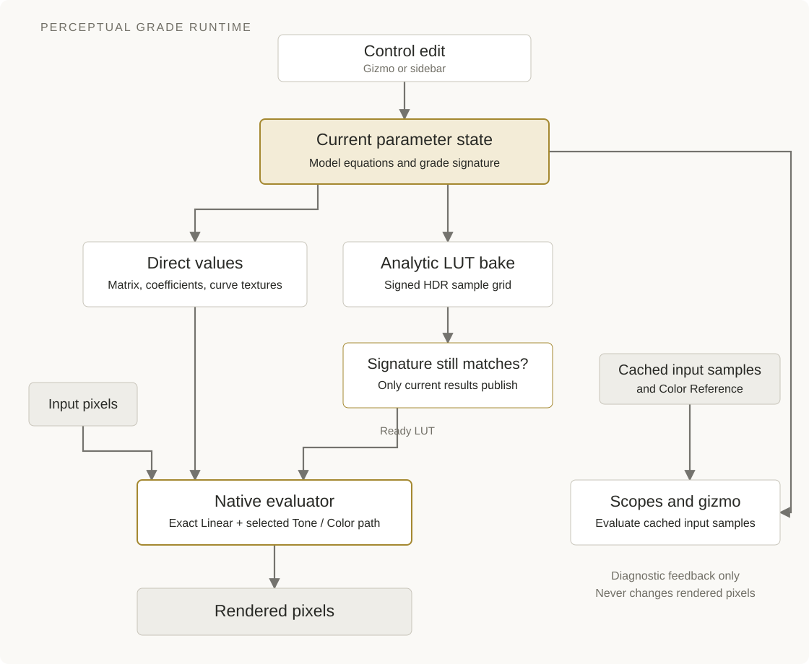

# Architecture and runtime

The extension's central job is to keep one current grade consistent while the reader edits controls, inspects scopes and renders through native nodes. The model owns the meaning of that grade. The runtime transports its values into the chosen evaluator and accepts completed work only when it still belongs to the current parameters.

An edit updates the grade's parameter state. Direct values can update immediately; a sampled color table becomes active only when its parameter signature still matches. Scopes evaluate cached input samples independently, and Color Reference remains diagnostic.

## Follow a control edit

Grade and Stack pencils derive their highlight from the single diagram target
in the current editor and its visibility. They do not store separate per-node
activation flags. Clicking another pencil makes its node active and replaces
the editor target; closing the diagram clears highlighting. A retained but
inactive Stack target is reopened when its pencil is clicked.

A gesture or sidebar edit enters through ui and updates the selected Grade's parameters (allocating a Grade only on the first actual edit). The model converts Linear controls into an exact matrix and Tone/Color controls into coefficients and curve data. Graph updates publish those values through the owning operator or timer. Changing the selected tonal region or UI page refreshes diagnostics without changing the grade.

The installed package root is src/blender. Its model modules implement matrices, appearance conversion, tone curves, color operators and sampling. The graph modules translate those results into native Shader and Compositor nodes. The ui modules own gestures and display; integration owns registration and cleanup. This separation lets a numerical change be checked before host evaluation enters the picture.

## Keep evaluators on the same grade

The extension builds Direct and Baked LUT paths into stable native graphs. A template for each node-tree type is cloned for additional nodes, and node groups are saved with the Blender document. Ordinary edits update uniforms, curve textures and LUT images while preserving graph topology.

For ordinary forward nodes, Linear remains an exact matrix ahead of either nonlinear path. Direct evaluates the current Tone and Color parameters through native operations and curve tables. Baked LUT evaluates the analytic model on the fixed native ACEScg/ACES-white 0…128 log1p grid, then supplies a paired native sampler. The [evaluation chapter](../theory/evaluation.md) explains their numerical approximations.

A completed bake carries the signature of the parameters that produced it. The runtime publishes it only if that signature still matches the current grade, including during a drag. While forward work is pending, current Direct values provide the preview. Render preparation finishes pending work for the selected method. GPU draw callbacks advance numerical snapshots; they never publish images or construct graph links.

The DCTL is a separate analytic implementation of the same grade inside Resolve. Its sources live in src/dctl, and the build combines the analytic body with locale-specific control declarations. It does not use the Blender node graph or its bake scheduler; parity tests connect the implementations at the model boundary.

## Cross compositor storage boundaries safely

Blender's compositor can store intermediate images in float16 under Automatic precision even when shader arithmetic is float32. The graph must therefore account for where a temporary result becomes an image, rather than assuming every intermediate retains shader precision.

Cell addressing is fused into bounded UV coordinates and physical fractions. One texture stores the base RGB plane and three forward-edge planes, independently encoded with signed mantissas and power-of-two exponents. Four texture reads select one base and the three ordered edges; fused multiply-adds accumulate them. Encoding small differences before half-float transport avoids subtracting quantized neighboring vertices. Shader lookup retains raw vertices. Curve textures similarly store endpoint values and derivatives with power-of-two scaling.

Creative gain, H–K repair and decoding share a shader operation. Cone conversion, signed lift and opponent subtraction are also fused where separate half-float buffers would lose needed information. Alpha follows a separate outer path. Precision and CPU/GPU selection remain host settings; these arrangements make the extension's graph respect their storage boundaries. The main implementation is in graph/compositor.py, graph/operations.py and graph/lut.py.

## Refresh diagnostic feedback

Ordinary Grade scopes evaluate cached sparse samples of the grade input, using the same current parameters as the evaluator. Image/RGB sources and supported grade chains can supply those samples directly. Render Layers resolves the scene, view layer and raw Combined pass through an owned 32-bit scene-linear EXR snapshot, sampling at most 256 by 192 pixel centers. A new render invalidates that cache. Unsupported procedural sources report which node cannot be sampled.

Color Reference is an independent diagnostic input. Its traces overlay the grade's scopes, and its pixels use the main sample's tonal selection in Color. For ordinary nodes, contribution histograms and near-neutral DetMCD statistics use only the Grade input. During Stack editing these statistics use the installed Stack output in the selected Grade’s context. Adaptance's contour describes pixel spread, not uncertainty in the mean. None of this diagnostic data changes rendered pixels.

## Own work through its lifecycle

Registration defers node-group construction until Blender permits data access. Operators and timers schedule bounded batches of pending changes; draw callbacks display cached results and can advance GPU numerical work. Offscreen sampling restores the preceding GPU state. Cleanup removes only the extension's handlers, timers, classes, caches and temporary snapshots.

When diagnosing a stall, separate node construction, shader compilation and frame evaluation. Capture terminal output and Python stack traces, then record the host version, working space, node type, method, precision, device and grade. That evidence identifies which boundary in the diagram needs investigation before broadening tests.

Blender's [compositor scheduling](https://github.com/blender/blender/blob/v5.2.2/source/blender/editors/space_node/node_compositor_job.cc), [shader operation limits](https://github.com/blender/blender/blob/v5.2.2/source/blender/compositor/COM_shader_operation.hh) and [result storage](https://github.com/blender/blender/blob/v5.2.2/source/blender/compositor/intern/result.cc) are the host references for these runtime boundaries.

## Share parameter ownership across editors

`graph/grades.py` owns `PGGradeData`, a parameter-only NodeTree ID. Nodes hold a `pg_grade` pointer to that ID. Linear RNA properties derive their values from the matrix and commit edits back to it. Node PropertyGroups hold local Tone/Color state for empty selectors and handle gestures; reads resolve a selected Grade as the authority. The Grade stores a double-precision Stage 1 XYZ matrix, its recorded white, the selected Working White and Tone/Color parameters, while Render Method, input connections and UI focus remain local. A shared edit synchronizes all users, then lets each node's existing evaluator/bake scheduler update its own resources.

`PGShaderGrade` and `PGCompositorGrade` expose a native `template_ID` selector in their draw callbacks. New creates a default Grade or duplicates the selected ID and its active Action. Unlink clears only the current reference. Data edits, pointer changes and batched handle writes use guarded transactions to avoid recursive updates. A cancelled first drag removes its newly allocated, unused Grade.

Regular save and disable operations replace the UI adapters with native group nodes, preserving socket identifiers/defaults, links, names, layout, settings and the Grade pointer. Save completion (including save failure) restores the UI adapters; load/re-enable performs the same restoration. Callers must reacquire node RNA objects after those lifecycle boundaries. Replacement copies extension RNA explicitly because Blender 5.2 stores it separately from ordinary ID custom properties. Rendering the stored native graph does not require registration of the custom node classes. Recovery/autosave snapshots may still require the extension.

Only nodes carrying the complete current-format markers are managed; other node groups are left untouched. Linked data stays read-only; creating a local Grade copy is the way to edit a linked Grade. Shared parameter keyframes target the Grade ID. Parameter sharing never merges Shader and Compositor evaluation graphs.

A zero-valued driver on each user node declares a dependency on the Grade ID, so Blender evaluates shared parameter animation through its own dependency graph. Portable representations mute this dependency. Node replacement transfers the owning tree's animation paths before deleting the old node, preserving socket keyframes and the dependency driver. In Blender 5.2, graph assignment is deferred until after the custom node's initialization/copy callback; assigning inside those callbacks can leave incorrect ID user counts.

## Ordered Stack entries and explicit Grade editing

`model/inverse.py` implements the float64 semi-analytic inverse, complete-forward refinement and reproduction diagnostics without a SciPy dependency. `model/transforms.py` composes immutable Grade snapshots. `graph/stacks.py` owns custom Shader/Compositor Stack nodes and node-local collections of Grade pointers/directions. Stack copies retain Grade sharing but copy the sequence independently. An unused SUM driver declares all referenced Grade animation dependencies.

Ordinary Grade nodes always apply forward and keep Render Method in the sidebar. Stack entries own enabled state and direction. Stack graphs contain one cube and no separate Stage 1. Signatures include all stages, directions and order of enabled populated entries; names, bypassed entries and editor focus are excluded.

Stack bakes first evaluate the nested 33³ grid, then only the remaining 65³ vertices. CPU inverse phases use a shrinking pool; GPU vertices run their own bounded solves. All shared float32 vertices are retained unchanged. Damped Broyden updates reuse Jacobians; safeguarded scalar Newton steps invert Tone and the fixed-reference guard. Optimized analytic forward evaluation shares curve and guard work and simplifies the neutral signed-lift offset. A cooperative cancellation token stops obsolete work. CPU workers operate on NumPy data only; GPU work and Blender data publication stay on the main thread. A running preview may finish during a continuous drag while newer edits coalesce into one successor. Obsolete final work is cancelled and cannot publish. Both scopes and native output read the installed 33³ or 65³ cube. These nodes pass input through before the first preview and require the latest 65³ cube during render preparation and normal save. Native save/disable adapters preserve the local collection explicitly. Downstream scopes can sample a baked Stack. No older-project conversion is performed.

## GPU context, scheduling and recovery

`model/gpu.py` owns the installed analytic float32 evaluator and nested-grid
Baker; `model/gpu_shader.py` contains its runtime shader source. `graph/gpu.py`
owns programs by window context, performs a float64-reference conformance
probe, and registers draw handlers for Node, Viewport and Image editors.
`graph/lut.py` uses these handlers for numerical dispatches and its timer for
RNA/image publication. GPU objects never enter the CPU executor.

Background execution explicitly calls `gpu.init()` on the main thread without
changing the render engine. Foreground execution requires a usable drawing
surface. Losing that surface/window, shader errors and unavailable physical
devices select the CPU. Matrix-only work and singular inverse matrices also
remain on the CPU. The UI reports this choice without adding a render method.

Parameter textures have a stable capacity, are uploaded once per snapshot and
are released on completion/cancellation. Input and output textures keep a fixed
1024×128 layout for tiny probes, partial batches and later edits; the output
texture belongs to the cached program. This avoids repeated layout specialization. Adaptive batches target approximately
20 ms of warm numerical work; a cold shader/driver compilation is synchronous
and can exceed this target. A batch includes input upload, the complete Grade
sequence, readback, device audits, AP1 conversion and
float32 storage. Flagged vertices share one CPU recovery pool at the end of
each preview/refinement phase; a table cannot publish until that pool is repaired.
The timer can publish a completed 33³ preview or 65³ final
after a callback finishes. A stale final never replaces current controls.

Undo/load resets numerical jobs while retaining compiled programs. Full
unregister removes draw handlers and releases those programs. Render/save
completion reuses current finished cubes; pending foreground GPU work switches
to CPU because lifecycle handlers have no guaranteed drawing context. If its
matching preview has been published, CPU refinement retains every shared vertex.
The float32 policy and audit are defined in the [math specification](forward-inverse-math.md#installed-gpu-evaluation-profile).

## Working-white and scene-coordinate boundaries

`model.linear.GradeSpace` uses fixed Rec.709 canonical grading coordinates interpreted through Bradford-adapted XYZ. `graph/spaces.py` samples Blender’s native scene-to-linear-Rec.709 conversion on RGB basis vectors, then inverts that same matrix for output. Scene changes affect these adapters only; their coefficients never replace Grade data. Shared white changes conjugate Stage 1 and invalidate the nonlinear model. An animated matrix retains its recorded white so conjugation also covers interpolated keys, NLA and drivers. No animation curves need rewriting.

The fixed LUT basis is native linear ACEScg/ACES white, with range 0…128 and plain log1p κ = 0.01. model/lut.py converts lattice inputs to canonical model coordinates, evaluates the complete analytic function, and converts results back before float32 storage. Its CPU facade applies the inverse coordinate changes around lookup. Ordinary forward graphs compose Stage 1, scene input and the AP1/ACES-white conversion for the LUT branch; Direct keeps separate canonical matrices. Stack graphs put composed scene/AP1 adapters around the one complete-chain cube. Signatures include chosen Grade whites and stored correction matrices, with the scene gamut excluded from the baked transform. Stage 1 controls, including diagram cancellation, never regenerate the stored matrix merely by reading it.

`graph/editing.py` holds a transient target for each editor. Its stable entry key follows an occurrence through collection reordering without creating helper nodes or copying Grade parameters. An explicit pencil click selects the target and opens the diagram. Bypassed, removed, unlinked or read-only targets cannot be edited. The sidebar and handles write to the shared Grade; entry-local focus chooses the displayed controls.

`graph/lut.py` snapshots the installed cube and the actual float32 native adapter matrices. `scopes/sampling.py` measures Stack Input and Stack Output with those resources, including while a replacement bake is pending. `scopes/color.py` measures completed output in the selected Grade context. No analytic sampled-image preview runs. The selected Grade model is used for control curves and handle math only.
