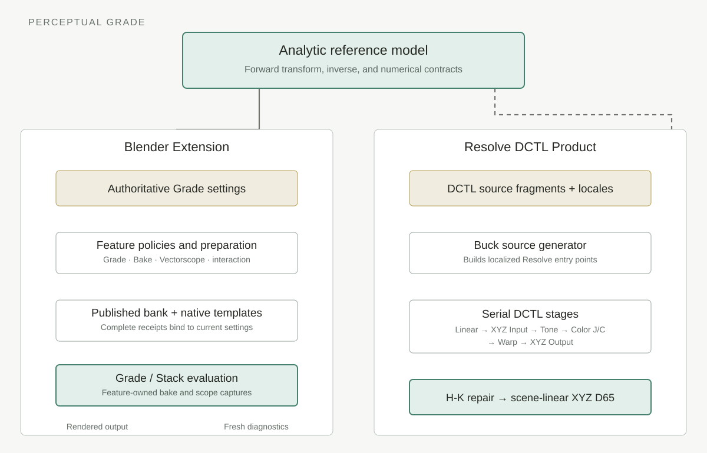

# Architecture and runtime

Perceptual Grade has one analytic model and two product adapters. The
reference library defines the grading equations and inverse contract. The
Blender extension prepares and publishes native node resources, while the
Resolve product generates an ordered chain of DCTLs. The adapters keep host
constraints at their boundaries and use the model as the mathematical source
of truth.

The reference model feeds two product paths. Blender prepares current Grade resources for native evaluation and diagnostics. Resolve builds localized DCTL stages that execute serially in a node chain.

## Shared model boundary

`libraries/perceptual-grade-reference` owns the analytic forward transform,
its inverse, and the numerical contracts used by the products. Product-specific
code handles authoring, host graph construction, storage, and execution. Tests
compare those adapters with the reference at the boundaries each product
supports.

Stage ordering is explicit in both products. Blender evaluates Linear, Tone,
and Color through a native Grade graph or a complete Stack LUT. The Resolve
chain applies Linear, converts scene-linear XYZ D65 into signed cone responses,
applies Tone and the two Color stages, then repairs H–K and decodes back to
scene-linear XYZ D65. Resolve keeps signed and HDR values in its XYZ domain.

## Blender runtime

| Area | Owner | Responsibility |
|---|---|---|
| Composition and public API | `src/__init__.py`, `src/application.py` | Add-on registration, shared callback router, feature startup, and ordered shutdown |
| Host callbacks | `src/host/callbacks.py` | Feature-owned Blender handlers and timers, with retryable removal |
| Grade | `src/features/grade/` | Authoritative settings, color authoring, preparation, parameter-bank publication, native nodes, and final-appearance endpoint |
| Bake | `src/features/bake/` | Route eligibility, freshness, capture jobs, image publication, and graph wrappers |
| Vectorscope | `src/features/vectorscope/` | Capture demand, source routes, freshness, analysis, editor interaction, and drawing |
| Gestures | `src/features/interaction/` | Shared gesture admission and coordination for Grade controls and the Gizmo |
| Shared runtime | `src/runtime/` | Reusable lifecycle, worker, resource, image-publication, and capture primitives |
| Numerical preparation | `src/kernel/` | Settings resolution, model preparation, runtime template binding, and kernel interfaces |

The composition root constructs one `HostCallbackRouter` and passes it into
Grade registration. Each feature registers callbacks under its own owner key.
The application coordinates feature shutdown and keeps retry state when host
cleanup fails. Feature callbacks own their response to Blender events; the
router owns callback installation and removal.

Grade settings are authoritative. Preparation derives complete immutable
resources from a settings snapshot. Publication stages every required role in
an inactive parameter bank, validates the receipts, then switches the shared
selector. Native graphs bind the prepared data through fixed templates. Render
preflight reconciles the current settings with the installed kernel before
evaluation. A current failure selects the visible error path and
alpha-preserving magenta output.

Bake and Vectorscope share capture primitives, while each feature owns its
eligibility rules and freshness decisions. Bake freezes a supported input and
settings snapshot before its worker evaluates the native graph. Vectorscope
uses the Grade-owned final-appearance endpoint and publishes analysis only
when the capture still matches current demand. The shared graph walker
provides observations and fingerprints, not feature policy.

Policy modules reduce events into state and authorized effects. Runtime
adapters execute those effects against Blender and return receipts where later
decisions depend on completion. This keeps transitions host-free and leaves
external mutations in the effect consumers. The policy chapter documents the
individual lifecycle contracts.

## Resolve DCTL product

The DCTL build assembles shared `.dctlh` fragments with localized control
declarations. Its product target emits five English files and five Simplified
Chinese files.

| Position | DCTL | Boundary |
|---|---|---|
| 1 | Linear | Scene-linear XYZ D65 adjustments |
| 1B | XYZ Input | XYZ D65 to signed cone responses |
| 2-3A | Cone Tone J/C | Integrated Tone and Unified Chroma controls |
| 3B | Cone Warp | Hue, chroma, Scale, and Adaptance controls |
| 4 | XYZ Output | H–K repair, Subtractive Density, optional saturation compression, and decode to scene-linear XYZ D65 |

`products/perceptual-grade-dctl/BUCK` declares the source tree, locale catalogs,
generator, outputs, and conformance targets. `src/` holds the shared DCTL
fragments and UI specification. The generator combines them into Resolve's
entry points and localized controls. The test harness compiles the generated
sources and checks interfaces, portability, numerical behavior, and ordering
against independent calculations.

Resolve users place the five stages on serial nodes in the listed order. Its
input and output boundaries accept scene-linear XYZ D65. The chain does not
apply Blender's RGB repair or AP1-D65 boundary mapping. After Warp, XYZ Output
performs H–K repair, applies Subtractive Density to achromatic lightness, then
optionally compresses saturation before decoding. Standalone Tone and Color
J/C and prototype variants have explicit opt-in build targets.

## Change ownership

Put a behavior change in the product feature that owns it. Keep shared runtime
primitives host-neutral and extract them when multiple features need the same
contract. Keep the analytic equations in the reference library, and update the
matching product tests when an adapter changes observable behavior. Build and
validation commands are documented in [Building, testing and provenance](building.md).
