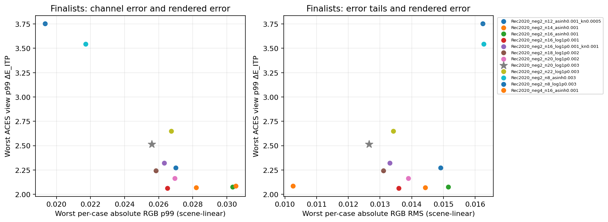
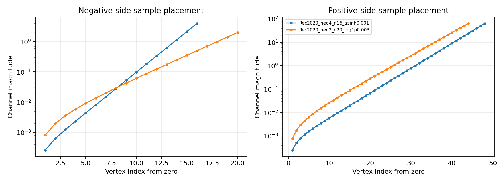

# Testing and measurements

Choose validation around the behavior you changed. Numerical tests isolate equations and invariants; DCTL parity tests compare the analytic reference; native-render tests check the graph actually evaluated by Blender. Packaging and documentation tests cover the artifacts readers and users receive. The [build chapter](building.md#run-tests) lists the targets.

A failing reproduction should identify the host version, input interpretation, grade, render method and device. Run the focused gate first, then the related integration gates. Report measured results with their workload and settings, so another contributor can reproduce them.

## Shared Grade regression checks

Run the ownership and real undo/redo fixtures with:

```sh
buck2 test //:blender_test_shared_grades //:blender_test_shared_grade_undo
```

These tests use real Blender RNA and native evaluation graphs. They cover empty selectors, lazy allocation and cancelled drags, cross-editor propagation, local Render Method and handle focus, independent copies, renaming, unlinking, retained unused data, Grade-owned keyframes, current-format node ownership, and save/load/disable/re-enable. The undo fixture exercises Blender's undo stack for shared edits, allocation, copies and unlinking.

`//:blender_test_white_and_render_ui` renders a Grade shared between Shader and Compositor users, then compares output with the extension disabled. The existing render fixtures also check native save/reload and packed LUT persistence. Selector draw tests validate the `template_ID` binding; interactive desktop operation and GPU rendering still require a desktop check.

## Grade and Stack editing regressions

Run the current authoring regressions through the same isolated Blender runner:

```sh
buck2 test //:blender_test_stack_editing //:blender_test_grade_stack \
  //:blender_test_working_white //:blender_test_shared_grade_undo
```

`test_stack_editing.py` invokes 53 pytest cases under `tests/blender/stack_editing/`.
Pytest and its exact development dependencies are pinned in `third_party`; they
are not part of the installed extension. The cases exercise compact controls,
shared ownership, enable/inverse state, Grade-node pencils, one active pencil
across multiple Grade and Stack nodes in both editor types, sidebar and close-button
synchronization, explicit pencil activation, occurrence
tracking during reorder, disabled editing, handle gestures and cancellation,
installed-LUT-only scopes, rejection of outdated bakes, native Shader/Compositor
CPU output, and current-format save/load/undo/disable/re-enable.

The original Stack and working-white fixtures continue to cover scheduling,
shared animation, signed RGB, alpha and coordinate invariance. Their inverse
operations now use single-entry Stacks. The ordinary Grade remains forward
with an independent Render Method. The undo fixture also covers entry bypass.
`inverse_reference.py` is a test-only Stage 2+3 adapter used by numerical solver
checks and historical precision studies; it does not provide an inverse node.

[The merged-source validation record](../downloads/grade-stack-ui-validation.json)
separates actual authoring runs from the Buck2 release gate and desktop/GPU checks.

## Progressive Stack bake measurements

The 1.18.0 regression gates are:

```sh
buck2 test //:numerical_test_progressive_lut //:numerical_test_cube_native \
  //:blender_test_stack_editing //:blender_test_grade_stack
```

They check nested-grid identity, exactly 274,625 total analytic samples for a settled preview/refinement pair, bit-for-bit common-vertex reuse, inverse diagnostic counts, cancellation and native sampling at both resolutions. The Blender cases cover preview publication, scope cache refresh, coalescing during continuous drags, deleted nodes, and final-render synchronization.

Three fresh numerical runs per case on Python 3.13.15 / NumPy 2.5.3, with one BLAS thread, produced these median times:

| Workload | Independent 65³ bake | First 33³ preview | Refinement only | Progressive total |
|---|---:|---:|---:|---:|
| Three forward Grades | 1.016 s | 0.121 s | 0.860 s | 0.979 s |
| One inverse Grade | 4.247 s | 0.996 s | 3.766 s | 4.830 s |
| Forward → inverse → forward | 4.693 s | 1.090 s | 4.192 s | 5.282 s |

Medians are taken separately, so columns need not add exactly. Timings exclude imports, scheduling delays, Blender image publication and rendering. They are numerical measurements on this host, not an interactive frame-rate or deadline guarantee. Two solver phases can add overhead even though the vertex count is unchanged; preview latency is the benefit. These measurements do not establish a sub-five-second final bake for all Stacks.

All nine refined 65³ tables were bit-for-bit identical to independent full bakes with the same parameters. This checks that refinement preserves final values for these workloads; 33³ previews still have coarser interpolation and are replaced before final rendering/saving. This timing run does not repeat the photographic display-error study.

[JSON with Grade parameters, environment and all runs](../downloads/progressive-bake-performance.json) / [CSV timings](../downloads/progressive-bake-performance.csv).

To repeat the timing measurement in an already prepared test tree:

```sh
python tools/testing/run_fixture.py --authoring-preview --tree . \
  --script tests/blender/benchmark_progressive.py \
  --output-dir /absolute/path/to/results --capture tests/blender/reports
```

Use the same generated inputs and environment described below. The timing script uses three repetitions by default and never reuses completed cube caches. This explicit authoring runner does not replace the Buck2 gate.

## CPU solver optimization and GPU exploration (1.22.0)

The installed CPU inverse now measures an analytic regular-system Jacobian,
including the reference-dependent H–K inverse. It reuses coefficient work,
skips inactive families and solves the two-variable normal step explicitly.
Its accepted forward function, iteration limits, candidate thresholds and
diagnostic tolerance are unchanged. The [math specification](forward-inverse-math.md#analytic-regular-jacobian)
defines these derivatives and their numerical branches.

Three interleaved fresh runs compared the supplied 1.21.0 solver with the
optimized solver on the current AP1 grid, using Python 3.13.15, NumPy 2.5.3
and one BLAS/OMP thread:

| Workload | Baseline 65³ | Optimized 65³ | Ratio |
|---|---:|---:|---:|
| One inverse Grade | 6.177 s | 4.425 s | 1.40× |
| Forward → inverse → forward | 5.230 s | 4.514 s | 1.16× |
| Three forward Grades | 2.236 s | 2.206 s | 1.01× |

This host showed substantial timing variation; retain every run rather than
interpreting the ratios as a workstation guarantee. Across the nine table
comparisons, the mixed/forward results were bit-for-bit identical and the
largest inverse table change was \(1.49\times10^{-8}\) in absolute RGB.
Every progressive table matched its independent full bake exactly, with all
common vertices reused. The 80 before/after accuracy checks cover 2,114
photographic/signed/HDR/neutral inputs per case, four whites and four Grade
configurations. The largest per-sample reproduction increase was
\(7.21\times10^{-10}\). Existing best-effort failures remain visible in the
data; this is not a proof of invertibility for arbitrary grades.

[CPU timings JSON](../downloads/cpu-solver-performance.json),
[CSV](../downloads/cpu-solver-performance.csv),
[accuracy JSON](../downloads/cpu-solver-accuracy.json), and
[derivative checks](../downloads/inverse-jacobian.json) retain parameters,
fixtures, environment and source fingerprints. Frozen baseline code lives
only in test fixtures and is excluded from the installed extension.

```sh
buck2 test //:numerical_test_inverse_jacobian //:numerical_test_cpu_solver_accuracy \
  //:numerical_test_inverse_solver //:numerical_test_inverse_math \
  //:numerical_test_progressive_lut //:blender_test_grade_stack \
  //:blender_test_stack_editing
buck2 build //:cpu_solver_benchmark --show-full-output
```

A cached Buck build result is an earlier timing sample. To collect fresh runs
in a prepared tree, use the explicit authoring runner:

```sh
python tools/testing/run_fixture.py --authoring-preview --tree . \
  --script tests/blender/benchmark_cpu_solver.py \
  --output-dir /absolute/path/to/fresh-results --capture tests/blender/reports
```

### GPU experiment (1.22.0 historical record)

The 1.22.0 frozen sources formed a developer experiment. Blender compiled its
Python-contained compute shader at runtime through
`GPUShaderCreateInfo`; no external GPU package or precompiled binary is installed.
Each invocation evaluates one vertex. It keeps the full Grade sequence,
regular two-variable inverse, scalar H–K/Tone inverses, and full-forward RGB
Broyden recovery on the device. Parameters use a fixed-capacity texture so
ordinary edits/short Stack changes can reuse the program and sampler layout.
The final table is read once per phase. A nested bake evaluates exactly
274,625 vertices, copying all 33³ common values into the final 65³ table.

The portable experiment uses float32. Its RGB stopping scale is
\(\max(10^{-12},\lVert y\rVert_\infty)\), with device cutoff
\(3\times10^{-6}\). Preserving relative accuracy in dark colors matters:
using the CPU's \(1+\lVert y\rVert_\infty\) normalization with a float32-sized
cutoff skipped small but visible dark adjustments. The fixed-reference guard
and tone Newton policies also use float32-sized thresholds. The installed
float64 CPU policy is unchanged. GPU audit fields count vertices needing RGB
recovery and those still above the device cutoff; they do not assert the CPU's
\(2\times10^{-8}\) diagnostic accuracy.

The full-grid software-renderer result and the independent photographic RGB/
four-output ACES comparison are in the [GPU exploration report](../downloads/gpu-solver-exploration.md),
with [JSON](../downloads/gpu-solver-performance.json),
[timing CSV](../downloads/gpu-solver-performance.csv), and
[photographic error CSV](../downloads/gpu-solver-photographic-errors.csv).
The report distinguishes warm bakes, driver compilation/first use and CPU repair.
Software-renderer timings cannot establish physical-GPU/Metal/Vulkan performance.
GPU baking was not selected by installed 1.22.0 nodes. The current source tools
now measure the installed implementation below; the downloadable 1.22.0
results retain their original source fingerprints and scope.

Run the opt-in arithmetic checks and a small context/dispatch probe with:

```sh
buck2 test //:gpu_solver_math
buck2 build //:gpu_solver_smoke --show-full-output
```

Run a fresh full measurement in a chosen desktop Blender:

```sh
buck2 run //:gpu_solver_benchmark -- \
  --blender /absolute/path/to/blender \
  --output /absolute/path/to/gpu-results/gpu-solver-performance.json \
  --full-grid --progressive --repeats 3 --repair
```

For photographic ACES metrics, also pass `--fixture-samples 2048` and
`--analysis-pythonpath /absolute/path/to/locked-analysis-wheels`. This directory
must supply the pinned test-only PyOpenColorIO wheel matching Blender's Python.
The wrapper enables Blender's explicit system-Python-path option for this run.
It uses factory startup and a private copy of the source tree. The same wrapper
can be invoked from source with `python tools/experiments/run_gpu_solver.py`.
No extension installation or existing project is needed. By default it rejects
software devices; `--allow-software` records a software correctness run explicitly.

The output includes shader/first-layout warm-up costs, every timing repetition,
complete Grade parameters, source/fixture/OCIO fingerprints, full-grid status,
device metadata, audit counts, separate scene/display eligibility counts,
JSON/CSV distributions and snapshots of evaluated code. Absolute RGB uses the
Rec.2020/D65 [0,10] input cube; ACES-rendered metrics use the AP1/ACES [0,128]
input cube. These independent masks are fixed at exact Stack input; pixels
outside both are excluded. GPU arithmetic, CPU LUT, and GPU LUT errors against
the complete float64 reference are separate measurements. Final render/save
publication and interactive scheduling are excluded from numerical timings.

These fixtures were executed with the pinned authoring-preview runtime.
Buck2 was unavailable on this host; its dependency/build gate and physical-GPU
desktop integration remain to be run on a supported workstation.

## Complete Metal matrix update fix (1.23.2)

The next Mac log showed one shader failure followed by CPU fallback, confirming
the 1.23.1 error policy. Compilation still rejected the `mat2` and `mat3`
rank-one matrices divided by a scalar. Both complete updates now operate on
vector columns before constructing a matrix; the solver equations and policy
are unchanged.

The arithmetic fixture reads every updated column for nonzero asymmetric
Jacobians and signed vectors. It checks the actual squared displacement and
small/large denominators, plus the two- and three-dimensional secant conditions.
The installed fixture retains the plain compiler/dispatch exception tests and
once-per-context fallback. Run the same `//:gpu_solver_math` and `//:gpu_baking`
targets below. [Validation data](../downloads/gpu-metal-matrix-fix.json) records
the current checks, source fingerprints and software-renderer scope. These
runs establish software OpenGL correctness, not native Metal compilation or a
new hardware performance measurement.

## Metal shader startup fix (1.23.1)

A supplied Mac log showed the compute shader failing on undeclared
`outerProduct`, followed by a plain `Exception: Shader Compile Error` escaping
the draw callback and triggering compilation on every redraw. The shader now
uses explicit column constructors for both Broyden rank-one updates. GPU
acquisition and dispatch catch ordinary exceptions, log/cache the failure once
per context, and let the timer publish the current CPU result.

The arithmetic fixture additionally checks both helpers with asymmetric signed
vectors. The installed fixture injects a plain compiler exception, checks the
single attempt and traceback, confirms that Preparing is cleared, and verifies
the current CPU LUT. Its dispatch-error injection also uses plain `Exception`.
Run the same `//:gpu_solver_math` and `//:gpu_baking` targets below.
[The fix validation](../downloads/gpu-metal-startup-fix.json) retains counts,
source fingerprints and the software-renderer scope. Physical Metal startup
and performance still require a Mac run. The 1.23.0 timing/photographic tables
below retain their original source snapshots; they are not new 1.23.1 timing
measurements. See [startup errors and logs](../guide/render-methods.md#gpu-startup-errors-and-logs).

## Installed GPU baking (1.23.0)

The installed implementation is `model/gpu.py`, `model/gpu_shader.py`,
`graph/gpu.py` and `graph/lut.py`. It automatically uses a physical graphics
device for nonlinear LUT work and reports the backend in the sidebar.
`tools/experiments/gpu_solver.py` is now a thin workstation-measurement adapter,
with an optional strict whole-grid CPU repair probe that is not installed.
The [render-method guide](../guide/render-methods.md#automatic-gpu-baking) explains
selection, first-use compilation and save/render CPU completion.

```sh
buck2 test //:gpu_solver_math //:gpu_baking
buck2 build //:gpu_solver_smoke --show-full-output
buck2 run //:gpu_solver_benchmark -- \
  --blender /Applications/Blender.app/Contents/MacOS/Blender \
  --output /absolute/path/to/results/gpu-solver-performance.json \
  --full-grid --progressive --repeats 3 \
  --fixture-samples 2048 \
  --analysis-pythonpath /absolute/path/to/locked-analysis-wheels
```

`--repeats 3` performs three fresh timed bakes for each workload; it does not
change inverse iterations or quality. The default workloads are one inverse,
forward → inverse → forward, and three forward Grades. Shader creation and
first-layout/driver warm-up are reported separately. Final numerical bake time
includes bounded dispatches, texture upload/readback, flagged CPU recovery,
coordinate conversions and float32 storage. Flagged vertices share one CPU
recovery pool per preview/refinement phase. It excludes UI debounce, editor
frame gaps, image packing/publication, imports and render time. `--repair`
adds a separate strict whole-grid verification experiment, not the production
flag-only repair policy. Buck's cached build output is an earlier timing sample.

The arithmetic fixture checks all eight whites, curve Fits, signed/HDR/dark
inputs and independent float64 forward reproduction. The installed fixture
uses actual Blender GPU objects to check automatic acquisition, context safety,
nested exact reuse, worker rejection, flagged recovery, cancellation,
draw/timer publication, edit coalescing, fallback, native output and cleanup.
Its software-renderer opt-in is fixture-local; installed users keep automatic
physical-device selection.

[The integration report](../downloads/gpu-baking-validation.md),
[checks and native measurements](../downloads/gpu-baking.json),
[fresh full-grid JSON](../downloads/gpu-baking-performance.json),
[timing CSV](../downloads/gpu-baking-performance.csv) and
[photographic distributions](../downloads/gpu-baking-photographic-errors.csv)
record the actual validation scope. Photographic masks, four ACES outputs and
reference semantics remain those of the earlier study. Current GPU LUT results
include device-flagged CPU repair; GPU arithmetic-only results measure the shader
without LUT interpolation. Float32 audit thresholds do not establish the CPU
residual tolerance for every unflagged vertex.

This host has a software graphics device. These authoring-preview checks do
not establish physical GPU/Metal speed, a tenfold gain, interactive desktop
behavior or the Buck2 release gate. Repeat the workload on the target Mac and
retain its device, cold costs and every warm run when assessing those goals.

## Measure render methods

Run the benchmark on the workstation whose results you want to publish. It uses your desktop Blender with a built extension, factory startup, a deterministic signed/HDR texture, fixed nonzero Tone/Color adjustments and identical render settings for both methods. Six cases cover Shader small/full and Compositor full with Baked LUT and Direct. Preparation includes graph setup, coefficient data and LUT completion; one warm-up precedes repeated render timings. Retain the complete JSON, rather than a single summary value.

Example on macOS, using Metal for Cycles and GPU compositing:

``` sh
buck2 run //:benchmark -- \
  --blender /Applications/Blender.app/Contents/MacOS/Blender \
  --backend METAL --compositor-device GPU \
  --width 1920 --height 1080 --samples 64 --trials 5 \
  --output /absolute/path/to/perceptual-grade/docs/data/benchmark.json
```

For Linux, point `--blender` to a full desktop binary and choose CPU, CUDA, OPTIX, HIP or ONEAPI as available. Record the actual selected GPU and desktop build. The worker reports the compositor device separately. The small material occupies approximately 12.25% of the frame; both shader cases use an emissive surface to isolate repeated material grading from complex lighting variation.

The checked-in `benchmark.json` is explicitly **illustrative**. A real run emits `status: measured` and device/version/settings metadata. Replacing that file and building `//:book_figures` updates the labelled chart and Markdown table together. `//:documentation_benchmark` uses six tiny native CPU cases to verify the runner; its timings are validation data, not publication measurements.


<p class="figure-caption">The supplied dataset is illustrative. Replacing it with workstation measurements updates this chart and table.</p>

{{#include ../assets/fragments/benchmark.md}}

[Download the benchmark data](../downloads/benchmark.json).

## Explicit authoring preview

Buck2 remains the release build/test gate. On a host where Buck cannot launch,
`tools/testing/run_fixture.py --authoring-preview --tree <prepared-test-tree>
--script tests/blender/test_chroma_drivers.py` runs the same fixture in an isolated
copy. Supply the pinned CPython/wheels, compiled catalogs, generated artwork,
localized DCTL/UI metadata and C++ host declared by `//:test_tree`. The runner
sets `PG_AUTHORING_PREVIEW`, never `PG_BUCK_TEST`, and labels the execution.
This mode does not validate Buck dependency resolution or satisfy its release gate.

The p=2 regression fixtures live in `tests/blender/fixtures/p2`. Their generator
is `tools/testing/freeze_p2.py`; it writes to a separate output directory for
review. Its independent long-double driver formula is in `tests/blender/p2_oracle.py`.
Historical fixture files and hashes are retained. Guard/grid checks still compare
the old baselines for grades with inactive low/high controls. The new baselines
cover intentional classifier changes at the original numerical tolerances.

`test_forward_inverse.py` validates the documented regular inverse on 48 mixed
grades' input samples and 2400 guard probes. It is a solver demonstration, not a
production inverse baker or a convergence guarantee for arbitrary grades.

## Working-white validation

`//:blender_test_working_white` checks all eight Grade whites, all three supported scene RGB spaces, matrix rebasing and decomposition, matrix-owned animation, both Add-menu entries, scopes, current-format save/load and reuse of ordinary/Stack LUTs after scene-space changes. It includes 24 native CPU renders across Shader/Compositor and Direct/Forward LUT/single-inverse Stack/mixed Stack paths. The 1.15.0 run passed 102 checks. [Download the native measurements](../downloads/working-white-native.json).

Working-space invariance and LUT approximation are separate tests: unchanged LUT coordinates preserve the same sampled function across scene spaces, but do not make that sampled function exact.

## Inverse and Stack precision

Run `//:numerical_test_inverse_math`, `//:numerical_test_inverse_solver`, `//:blender_test_grade_stack` and `//:blender_test_shared_grade_undo` for inverse equations, node behavior, native rendering, persistence and undo. `tests/blender/evaluate_working_white_precision.py` measures the current fixed LUT boundaries, with D65, ACES and D50 Grades in a Forward → Inverse → Forward sequence.

The earlier 1.15.0 Rec.709 report used 2,048 sampled pixels from each IMG_* fixture, converted from their original linear Rec.2020 coordinates without clipping. Mixed Stack p99 normalized RGB error is 0.000371–0.001575, lower than three separate LUTs in all four samples. Individual errors can be much larger: IMG_0472 has a Stack maximum of 0.082083 and ordinary inverse maximum of 0.206524. Extreme signed colors and extrapolation also have substantial errors. One cube removes intermediate interpolation but does not guarantee higher accuracy for every pixel.

Normalization is max absolute RGB error divided by 1 + max absolute reference RGB; it is not perceptual ΔE or percent brightness. The ordinary inverse bake reports 174 approximate vertices out of 274,625; the mixed Stack reports 130. These are solver reproduction diagnostics before LUT storage/interpolation. [Download the historical 1.15.0 measurements and Grade settings](../downloads/working-white-precision.json). The implementation includes `docs/engineering/working-white-validation.md` with complete tables and validation scope. Native CPU lookup tests, inverse solving and interpolation measurements remain separate; GPU/Metal results are not claimed.

That historical precision run took 4.08 seconds for the ordinary inverse, 5.13 seconds for the mixed-white Stack and 1.05 seconds for a forward Stack. These are single-run numerical bake measurements excluding Blender publication and the edit debounce. They do not guarantee a deadline for every grade or machine.

## LUT sampling and ACES 2.0 display error

Version 1.16.0 replaces the previous Rec.709 LUT with **fixed linear Rec.2020/D65, −4…+64, 16 negative / 48 positive cells and positive asinh κ = 0.001** for every Blender working space. The selection study compared 50 configurations, including fixed Rec.2020/D65, smaller negative ranges and four shaper families. It evaluates all 338,688 stored pixels from the four IMG_* fixtures for ten finalists, with four finalists also checked at −2 and +2 stops of input exposure. The stored fixtures sample every twelfth row and column of the original EXRs; this is not a full-resolution original-image evaluation.

The study retains scene-RGB errors and adds absolute-light ΔE_ITP after the actual OCIO ACES 2.0 transforms: SDR 100 nits Rec.709, SDR 100 nits P3-D65, HDR 1000 nits P3-D65, and HDR 1000 nits Rec.2020, all with D65 creative white. Luminance error in nits, encoded-channel errors and fractions above ΔE_ITP 1/2/5 are also recorded. These display measures complement RGB error because the view transform changes the visibility of scene-linear differences.

Each value below is the largest per-case p99 ΔE_ITP across four images and five ordinary/Stack workloads, using all stored pixels at original exposure. It is not a pooled percentile or a maximum-pixel error.

| ACES 2.0 output | Previous Rec.709 | Selected Rec.2020 |
| --- | ---: | ---: |
| SDR 100 nits Rec.709 | 3.308 | 1.510 |
| SDR 100 nits P3-D65 | 3.683 | 1.617 |
| HDR 1000 nits P3-D65 | 3.938 | 1.726 |
| HDR 1000 nits Rec.2020 | 4.105 | 1.823 |

At input exposure −2 / 0 / +2 stops, the worst p99 across all outputs is 1.374 / 1.823 / 2.086 for the selected grid, versus 2.998 / 4.105 / 6.385 previously. At +2 stops, five pixels in an 84,672-pixel case exceed the −4 bound (0.00591%). The largest original-exposure error remains 11.738 ΔE_ITP; this is not a visually lossless transform. ΔE_ITP 1 is a sensitivity reference, not a universal visibility threshold.

The historical production measurements used `tests/blender/run_lut_study.py evaluate_lut_sampling --production --mode full --ocio-config /path/config.ocio --output /fresh/results`. The current `--production` option follows the current policy and does not recreate the historical selected grid. The display comparison requires Blender's OCIO 2.5.0 ACES 2.0 implementation for this comparison. [Download production per-case measurements and metadata](../downloads/rec2020-production.json). The full forward/inverse math and explicit sampling-basis equations are maintained [in this handbook](forward-inverse-math.md).

The selected Rec.2020 configuration with range −4…+64, 16 negative cells and positive asinh κ = 0.001 reduces the worst per-case p99 ΔE_ITP from 4.105 to 1.823 at original exposure, although normalized scene-RGB p99 rises from 0.003427 to 0.004296. It also increases the worst fraction above ΔE_ITP 1 from 4.55% to 6.46%. The 12-negative-cell alternative has fewer moderate errors but a worse p99 at +2 stops. Smaller negative bounds reduce coverage; extrapolation remains possible. No configuration improves every metric. The choice prioritizes the worst p99 across the tested outputs and input exposures, while retaining the moderate-error fractions and domain exits in the report.

That historical 1.16.0 Rec.2020 boundary was fixed across Blender scene spaces. Surrounding gamut/Bradford matrices convert to and from it; each Grade retains its own white and grading function. Changing the LUT basis must not change the model's primaries, anchors or Grade interpretation.

The source tools are `tests/blender/run_lut_study.py`, `evaluate_lut_sampling.py`, `lut_sampling.py`, `aces_metrics.py`, `test_lut_study.py` and `report_lut_sampling.py`. The 123 focused checks cover the sampler, extrapolation, scene-space covariance, independent ITP/PQ calculations and OCIO output-path agreement. OCIO, Colour and Matplotlib are analysis dependencies only. The historical production `Baker`/`Cube` evaluation reproduced the 1.16.0 selected experiment’s original-exposure summary values. The independent sampler checks, frozen analytic fixtures, native Shader/Compositor tests and working-space invariance checks cover integration. These results are not a native GPU test or a completed Buck2 release gate. [Read the original selection report with figures and reproduction commands](../downloads/lut-sampling-report.zip) or [download the summary data](../downloads/lut-sampling-summary.json).

The historical 1.14.1 [precision](../downloads/inverse-stack-precision.json) and [performance](../downloads/inverse-bake-performance.json) data remain available. Those measurements use a different RGB basis and Grade-white setup, so their errors are not a direct comparison with 1.15.0. `tests/blender/benchmark_inverse.py` measures repeated fresh numerical bakes; the older engineering report describes the Python-only solver redesign.


## Reproducible LUT shaper experiment

The subsequent [+128 domain study](lut-domain-study.md) uses independent scene-RGB and ACES-rendered-RGB masks, adds native ACEScg/ACES white and fixed-primary AP1/D65 sampling, and extends the photographic exposure sweep. Its specifications, Buck2 targets and result tables are separate from the historical −2…+64 study below.

Version 1.20.0 adds a declared Buck2 comparison of **82 grids** for the requested −2…+64 domain. The previous −4…+64 production grid remains a measurement baseline. The specification is `tests/blender/experiments/lut-shaper.json`: it contains the exact photographic fixture paths and SHA-256 hashes, three complete shared Grade definitions (matrices, whites and Tone/Color parameters), five workloads, exposure offsets, seed, shaper families/scales, negative allocations, output transforms and selection rule. `lut-shaper-matched.json`, `lut-shaper-negative.json` and `lut-shaper-refinement.json` record the three authoring batches. Editing the main specification invalidates its Buck2 input and recomputes the comparison.

```sh
buck2 build //:lut_shaper_evaluation //:lut_shaper_report --show-full-output
buck2 test //:lut_shaper_experiment_test
buck2 test //:lut_shaper_full_result_test
buck2 build '//:lut_shaper_evaluation[selection]' \
  '//:lut_shaper_evaluation[metrics]' '//:lut_shaper_evaluation[metadata]' \
  '//:lut_shaper_evaluation[full]' --show-full-output
```

The smoke test runs a small photographic subset and verifies the artifact contract. The full-result test depends on the full experiment and independently reconstructs the selection from the per-case metrics. The full comparison takes substantially longer than an individual LUT bake because it renders millions of pixel comparisons through four ACES transforms for every candidate. Buck2 caches results when declared inputs remain unchanged.

The evaluator uses the pinned development `bpy` wheel to extract the **complete stock Blender OCIO configuration and resources**, and the pinned PyOpenColorIO 2.5.0 CPU implementation. No installed desktop Blender path or ambient `OCIO` environment variable is needed. `bpy`, PyOpenColorIO, Colour and Matplotlib are development dependencies; PyOpenColorIO is absent from the installed extension. The source inventory, dependency locks, configuration/resource fingerprints, model source fingerprints and numerical parameters are captured in the result metadata. Numerical metrics are the reproducibility contract; elapsed times and platform metadata vary between runs. BLAS/OMP threads are fixed to one before loading NumPy.

### Inputs and analytic reference

The four IMG_* fixtures contain **338,688 stored pixels**, sampled every twelfth original EXR row and column. Every stored pixel is tested at −2, 0 and +2 stops, giving 1,016,064 inputs per workload. Signed inputs are retained. Forward Grade, whole-Grade inverse, inverse round trip, three-forward-Grade Stack and forward/inverse/forward Stack are separate workloads. Stage 1 stays outside the ordinary forward cube and is included in every Stack cube, including the single-entry inverse. All three Grades use their recorded working whites and the current Bradford connections.

Each cube stores float32 values calculated directly from the float64 analytic Grade/Stack path, including bounded selected-inverse root solving. Between vertices, the independent prototype locates cells with `searchsorted` and performs tetrahedral interpolation using **physical linear-RGB distances**. The production sampler is checked against that prototype separately. Solver diagnostics and vertex hashes are recorded. The inverse reference is the selected analytic/numerical inverse function; it is not an assumption that all grades have an exact round trip.

A deterministic screening subset uses 2,048 pixels per fixture. The four best balanced candidates, two best display candidates, two best absolute-RGB-p99 candidates, the baseline and explicit mandatory candidates enter full validation. Repeated choices count once. Every stored pixel is included in full validation; screening-excluded heldout distributions are also recorded. “Best” means best among that fully validated shortlist, rather than a proven optimum over every possible shaper or grade.

### Metrics and ranking

For a reference RGB \(\mathbf r\) and sampled RGB \(\hat{\mathbf r}\), the per-pixel absolute scene error is

$$
e_{\mathrm{RGB}}=\max_{j\in\{R,G,B\}}|\hat r_j-r_j|.
$$

It is measured separately in Linear Rec.709, Linear Rec.2020 and ACEScg, using the stock OCIO conversions. Normalized error \(e_{\mathrm{RGB}}/(1+\max_j|r_j|)\) and relative error with a 0.001 denominator floor are also retained. Absolute RGB RMS is \(\sqrt{\operatorname{mean}(e_{\mathrm{RGB}}^2)}\): it is the RMS of the per-pixel maximum-channel error, not an RMS pooled over channels.

The four output transforms are SDR 100 nits Rec.709/BT.1886, SDR 100 nits P3-D65/sRGB, HDR 1000 nits P3-D65/PQ and HDR 1000 nits Rec.2020/PQ, with D65 creative white and no additional look or view exposure. The P3 HDR path uses the same OCIO ACES 2.0 output built-in even though stock Blender does not list that display pairing in its UI. Rendered differences include absolute-light ΔE_ITP, luminance nits, encoded-channel error, display-linear RGB nits and fractions above ΔE_ITP 1, 2 and 5.

Each statistic is computed **per fixture × exposure × workload**, then the worst case is taken. Percentiles are not pooled across fixtures. The predeclared balanced objective minimizes the largest ratio to the previous grid across **ten terms**: four worst per-case rendered p99 ΔE_ITP values, three absolute scene-RGB p99 values and three absolute scene-RGB RMS values. All terms have equal standing in this minimax rule; a ratio above one identifies a regression. Ties use the worst rendered p99 and then the grid name. The rule requires a nonzero baseline error, so an identity-only grade is unsuitable for this ratio objective. Maxima and all other statistics remain in the tables even though they do not determine the ranking.

### Outputs and authoring execution

`metadata.json` stores inputs, model/configuration versions and fingerprints; `selection.json` identifies the selected grid and objective; `screen-ranking.json` and `full-ranking.json` contain rankings. Per-grid `screen/` and `full/` JSON files retain every case, heldout distribution, worst-pixel coordinate, domain exit, RGB/display metric and solve diagnostic. `metrics.csv` and `ranking.csv` provide flattened tables. `manifest.json` fingerprints every non-cache output. The report target produces two scientific figures and `report.md`. Numerical cache files are build intermediates and are excluded from the downloadable report.

The evaluator can also run as an explicitly labeled authoring check, with the pinned analysis dependencies available:

```sh
python -m tools.experiments.ocio_snapshot --output-dir /fresh/ocio
python -m tools.experiments.lut_shaper --tree . \
  --spec tests/blender/experiments/lut-shaper.json \
  --ocio-config /fresh/ocio/colormanagement/config.ocio \
  --output-dir /fresh/results
python -m tools.experiments.check_lut_result --results /fresh/results
python -m tools.experiments.report_lut_shaper --results /fresh/results \
  --output-dir /fresh/report
```

The bundled authoring measurements were produced in three candidate batches, with identical fixtures, Grades, outputs, seed, screening samples and objective. Their input metadata is retained, and the exact global shortlist is reconstructed. They are not labeled as Buck2 execution: Buck2 cannot start in the authoring environment because `/proc/self/exe` is unavailable. The declaration/input audits, generator entry points, numerical checks and artifact verifier passed; the native Buck2 build/test gate still needs a normal supported host.


### Recorded 1.20.0 comparison

The 82-grid screen selected 12 full finalists. The measured balanced winner in the requested range is **Rec.2020/D65 −2…64, signed log1p, 20 negative / 44 positive cells, positive κ = 0.003**, with slope-matched negative κ = 0.0019620422371104795. The table retains the previous grid and the best full-finalist display-p99 alternative.

| Worst per-case metric | Previous −4 / 16 asinh .001 | Selected −2 / 20 log1p .003 | Display alternative −2 / 16 log1p .001 |
|---|---:|---:|---:|
| SDR100_Rec709 p99 ΔE_ITP | 1.847365 | 2.183193 | 1.706017 |
| SDR100_P3D65 p99 ΔE_ITP | 1.871935 | 2.245625 | 1.827746 |
| HDR1000_P3D65 p99 ΔE_ITP | 2.075527 | 2.501072 | 1.922715 |
| HDR1000_Rec2020 p99 ΔE_ITP | 2.085620 | 2.514019 | 2.063685 |
| Linear Rec.709 absolute RGB p99 | 0.03051798 | 0.02558292 | 0.02650314 |
| Linear Rec.709 absolute RGB RMS | 0.01025971 | 0.01265570 | 0.01359318 |
| Linear Rec.2020 absolute RGB p99 | 0.02595036 | 0.02195883 | 0.02310018 |
| Linear Rec.2020 absolute RGB RMS | 0.00865254 | 0.01107384 | 0.01191678 |
| ACEScg absolute RGB p99 | 0.02521603 | 0.02129752 | 0.02237522 |
| ACEScg absolute RGB RMS | 0.00842654 | 0.01074439 | 0.01156180 |
| Balanced ratio to previous grid | 1.000000 | 1.279837 | 1.377258 |
| Worst fraction outside cube | 0.005905% | 0.184240% | 0.184240% |

The selected curve reduces the worst absolute RGB p99 from 0.030518 to 0.025583 (about 16.2%), but worst rendered p99 increases from 2.085620 to 2.514019 (about 20.5%), and worst absolute RGB RMS increases from 0.010260 to 0.012656 (about 23.4%). Its minimax ratio is 1.279837: **the previous wider grid is still better on the joint objective**. Under the mandatory −2 lower bound, this is the best tested balanced finalist. If displayed p99 alone is the goal, the 16-negative-cell log1p .001 variant is preferable, with larger RGB RMS. Ordinary forward Grade errors improve for the selected curve; Stack/inverse cases determine the overall tradeoff.

The ACEScg nonnegative [0,64]³ corner calculation agrees with the proposed negative bound to stock-processor precision: minimum blue ≈ −1.939416. It also produces positive blue ≈ +65.939415, so +64 is not complete source-cube coverage. More significantly, the stored signed fixture inputs at +2 stops reach −4.902344 at a Stack LUT boundary; 137 pixels in that case lie below −2, compared with five below −4. The worst outside fraction across all workloads is 0.184240% for −2 versus 0.005905% for −4. These pixels are included in every percentile, RMS and display calculation and use continuous boundary-cell extrapolation. None is silently clipped or discarded. A source conversion bound therefore does not establish that −2 improves grading accuracy.





[Download the selected grid and scores](../downloads/lut-shaper-selection.json) or [the complete recorded JSON/CSV results, figures, input metadata and current-source confirmation](../downloads/lut-shaper-report.zip). The source package contains every referenced fixture and specification. Native CPU Shader/Compositor sampling, 33/65 nesting and half-buffer transport are validated separately from these float64-reference interpolation errors. GPU/Metal precision is not claimed.

## Native AP1 production LUT (1.21.0)

Production now uses `AP1_ACES_neg0_pos128_n0_log1p0.01`: native ACEScg/ACES white, [0,128], 64 positive intervals, plain log1p κ = 0.01. [The domain study](lut-domain-study.md#adopted-production-choice) records why this display-linear/peak-nits choice differs from the encoded-RGB winner. Historical comparisons above retain their original parameters.

```sh
buck2 test //:numerical_test_cube_math //:numerical_test_cube_native \
  //:numerical_test_progressive_lut //:numerical_test_lut_grid_regression \
  //:numerical_test_hk_fixture_regression
buck2 test //:renders_blender_cube_test //:blender_test_working_white \
  //:blender_test_grade_stack //:blender_test_stack_editing \
  //:blender_blender_half_precision_test
```

The independent AP1 oracle reconstructs primary matrices, Bradford adaptation, the axis and physical interpolation separately. Analytic fixtures remain frozen. Tests retain signed/HDR extrapolation, all eight Grade whites and three scene spaces, Shader/Compositor rendering, alpha, current-format save/load/undo, shared Grades, and exact 33³/65³ vertex reuse. The half-float buffer test covers the single-image base/edge encoding; Shader retains raw vertices. Native CPU and buffer-emulator checks are distinct from GPU/Metal acceptance.
