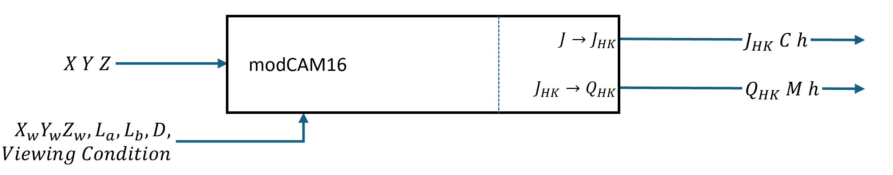
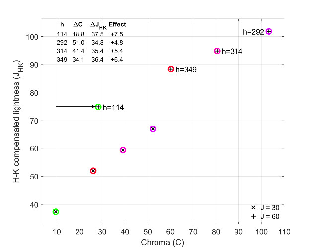

# Appearance coordinates and grading

Stage 1 is a linear color transform. The reference then repairs the input into its native AP1 cube and encodes it in modCAM16. Tone and Color operate on appearance coordinates; RGB export applies cube containment and decoding after Stage 3. This chapter introduces that representation, especially the coordinates used by the Color controls.

This part describes the current analytic model in `libraries/perceptual-grade-reference`. Archived 1.23.2 controls, instructions and measurements are identified separately. The frozen Blender implementation retains its earlier Warp ordering; Next Blender has not implemented Warp yet and will use the corrected reference. Product features and historical releases therefore need their own scope labels.

modCAM16 is a revised color appearance model in the CAM16 family. It describes how a color looks under specified viewing conditions, separating lightness, chromatic strength and hue. Perceptual Grade uses its revised relationships and Helmholtz–Kohlrausch compensation, which accounts for chroma’s contribution to perceived lightness.

Reference illustration: Agahian and Stolitzka, “Modeling Perceived Brightness in HDR Displays” (2025), Figure 2. XYZ and viewing conditions lead to relative lightness/chroma/hue or absolute brightness/colorfulness/hue. The figure describes their model framework, not this tool's node graph. <a href="https://doi.org/10.2352/CIC.2025.33.1.7">Source</a>.

The signed lightness coordinate is \(H\), also written \(J_{\mathrm{HK}}\). It includes the H–K contribution and is labelled J in the interface. Lightness J adjustments change this coordinate. Tone and tonal selection use the nonnegative magnitude \(M=\sqrt{J_A^2+66C}\), which equals \(H\) when \(J_A\ge0\). The achromatic component, \(J_A\), enters the saturation calculation and the H–K repair.

Chroma \(C\) measures distance from neutral in the grading opponent plane; hue \(h\) gives the angle around it. The corresponding Cartesian coordinates are \(a=C\cos h\) and \(b=C\sin h\). Chroma controls change the radius, Hue rotation turns the plane, and the directional pads use its signed \(a\) and \(b\) coordinates.

In the chroma plane, moving outward at fixed \(h\) increases \(C\); moving around the plane changes \(h\). Moving \(a\) or \(b\) can change both. A Lightness J adjustment changes \(H\); a Chroma \(C\) adjustment changes the radius; selective Adaptance changes the opponent position and achromatic energy. Tonal selectors determine how strongly each operation acts. The [Warp saturation pad](color.md) uses a different, compact coordinate that also depends on achromatic energy.

$$
H=J_{\mathrm{HK}}=\sqrt{J_A^2+66C}\quad (J_A\ge0),\qquad
C=\sqrt{a^2+b^2},\qquad h=\operatorname{atan2}(b,a).
$$

The identity holds on the nonnegative achromatic branch. Negative achromatic values use a reflected branch. Write \(B=\sqrt{66C}\), distinct from the opponent coordinate \(b\):

$$
H=2B-\sqrt{J_A^2+B^2}=2B-M\quad (J_A<0).
$$

The branches meet continuously at \(J_A=0\), where \(H=B\). A chromatic point there is still nonblack; only \(M=0\) identifies black. With \(u=H-B\), the exact inverse is \(E=u(|u|+2B)=J_A|J_A|\). The implementation carries this signed energy separately through Color so tiny achromatic values survive even when rounded \(H\) equals \(B\).

Reference illustration: the same paper, Figure 3. The markers compare chroma and H–K-compensated lightness for several hues at two achromatic-lightness levels. This is a published model example, not a measurement of the running SDR/HDR grades. <a href="https://doi.org/10.2352/CIC.2025.33.1.7">Source</a>.

The grading plane uses actual \(C\) as its radius. Do not substitute textbook CAM16-UCS \(M'\) or other compressed uniform-space coordinates for these \((a,b)\) values. The shared vocabulary does not make the numerical scales interchangeable.

On the nonnegative branch, normalized lightness is \(j=H/100=M/100\). A reference-white neutral has \(H=100\); HDR lightness can continue above it. Defaults are Reference Nits = 203 and adapting luminance \(L_A=20.3\) nits, with dark-surround constants \(c=0.525\) and \(N_c=0.8\). Encode and decode share the same hue-eccentricity expression, including \(-0.1475\sin h\).

The reference fixes \(Y_b=10\) on Colour's scale where the test white has \(Y_w=100\), with the illuminant discounted. Internally, XYZ and the white \(W\) use \(Y=1\) units; normalized cone inputs are \((A\,XYZ)/(A\,W)\), with \(A\) the CAT16 matrix. The background setting is distinct from the adapting luminance of 20.3 nits.

The complete analytic `Model` accepts Grade white D65 with Reference Nits 203, matching its cached boundary context. Its lower-level appearance and Tone helpers accept a wider effective reference range. The archived products offer the eight white presets and Reference Nits controls described in [Working White](../guide/working-white.md); that product interface does not widen the complete reference model's supported context.

The distinction matters on the negative branch: Tone remaps \(M\), preserves the sign of \(J_A\), then reconstructs \(H\). Color's tonal selectors also use the post-Tone \(M\). Replacing that magnitude by signed \(H\) would change which tonal controls affect the color.

The [saturation-preserving tone curve](tone.md) remaps lightness while maintaining the tone-stage invariant. [Tone-shaped color operators](color.md) then blend adjustments across tonal regions. [Evaluation and interpolation](evaluation.md) follows the bounded H–K guard and the analytic, native and sampled implementations.

The current RGB entry path applies Stage 1, repairs into native AP1 \([0,1024]^3\), then encodes the result. Appearance helpers also support signed cone responses directly. The paired neutral lift, subtraction and fallback levels described for 1.23.2 are historical behavior. Reset remains an identity within the legal input cube; out-of-cube input still receives entry repair.

Stage 3 evaluates J/C edits, Warp hue/chroma, selective Adaptance, H–K repair, then common positive Scale. With the default guard enabled, nonnegative-\(H\) requests are repaired and negative-\(H\) requests bypass repair; Scale multiplies either carried energy by \(\lambda^2\), preserving its sign. Appearance handoffs carry that post-policy state, and RGB export applies only the separate cube guard. The [guard chapter](hk-guard.md) explains the nonnegative-energy guarantee and its branch conditions; [credits](../reference/credits.md) lists the model references.
