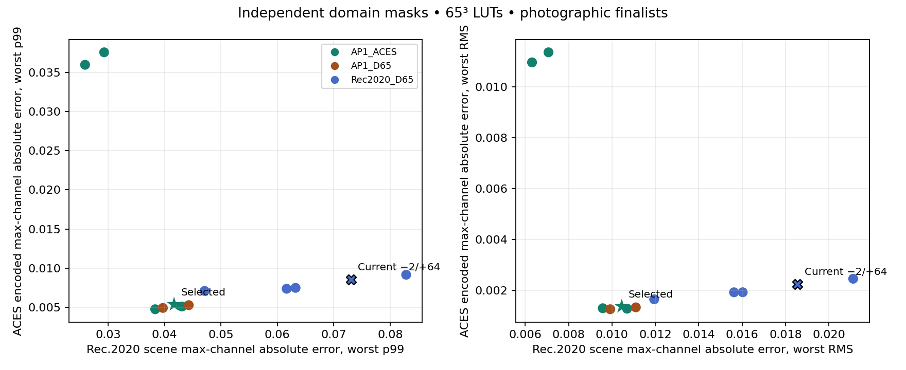
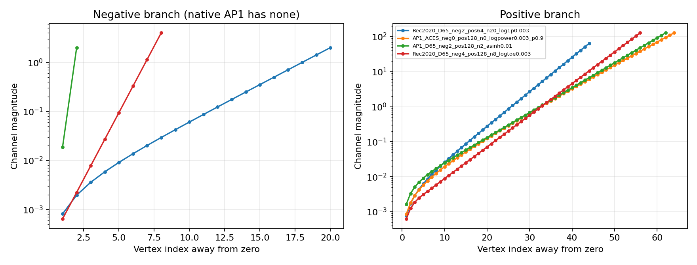

# LUT +128 study

Best measured candidate: **AP1_ACES_neg0_pos128_n0_logpower0.003_p0.9**.

This is a sampling study. The extension’s current production LUT remains unchanged pending adoption. No project migration or compatibility code was added.

## Fixed domains and ranking

- Scene metric: exact LUT input inside the closed Rec.2020/D65 `[0,10]³` cube. Compare analytic and sampled output as absolute scene-linear Rec.2020 RGB.
- ACES metric: exact LUT input inside the closed native ACEScg/ACES-white `[0,128]³` cube. Compare the rendered output through four ACES 2.0 transforms.
- These are separate masks. A pixel may contribute to either or both; pixels outside a domain do not contribute to that domain. Membership is fixed before testing any candidate, with strict float64 comparisons.
- “LUT input” means after Stage 1 for an ordinary forward Grade, the forward result for inverse roundtrip, and the input of the complete Stack otherwise.
- ACES ranking uses maximum absolute channel error in encoded RGB (BT.1886, sRGB, or PQ). Emitted RGB in nits, emitted RGB/peak nits, luminance error and ΔE_ITP are additional diagnostics.
- The objective minimizes the maximum ratio to the current production baseline over ten worst per-case terms: scene RGB p99/RMS and encoded RGB p99/RMS for each of four outputs. A ratio below one improves every selected term. Tie breaks are mean ratio, then grid name.
- A “case” is one fixture, exposure and grading workload. Full validation includes all stored photographic samples. Heldout results exclude screening pixels; they are reported separately.

## Sampling bases and range

All candidates bake the same physical grading function, including the same Grade working whites. Changing the sampling basis does not change the grading intent. Coordinates are converted back to canonical Linear Rec.709/D65 before analytic evaluation.

| Basis | Definition | Native AP1 [0,128]³ minimum | Maximum | Tested lower bounds |
|---|---|---:|---:|---|
| Rec2020_D65 | Rec.2020 primaries, D65; stock OCIO | -3.878832889 | 131.878837678 | -8, -4 |
| AP1_ACES | Standard ACEScg, ACES white; stock Bradford | 0.000000000 | 128.000000000 | -0.0 |
| AP1_D65 | AP1 xy primaries normalized to D65; experimental, not standard ACEScg | -1.167199713 | 129.167198395 | -4, -2 |

The lower bound is checked against analytic extrema of the native AP1 source cube. The fixed +128 upper bound cannot contain every transformed AP1 corner in the two D65 bases. Eligible out-of-grid queries remain in the metrics and use physical-linear boundary extrapolation; no RGB is clipped. “No negative” for native AP1 describes its sampling axis, not clipping of input or output colors.

## Full photographic finalists

| Grid | Scene p99 | Scene RMS | Encoded p99 | Encoded RMS | Balanced ratio | Display extrapolation, worst case |
|---|---:|---:|---:|---:|---:|---:|
| AP1_ACES_neg0_pos128_n0_logpower0.003_p0.9 | 0.04168850 | 0.01044772 | 0.00538943 | 0.00137624 | 0.725347 | 0.00000000% |
| AP1_ACES_neg0_pos128_n0_log1p0.01 | 0.03834440 | 0.00957414 | 0.00477992 | 0.00130551 | 0.842753 | 0.00000000% |
| AP1_ACES_neg0_pos128_n0_asinh0.01 | 0.04309058 | 0.01069441 | 0.00513114 | 0.00128938 | 0.843557 | 0.00000000% |
| AP1_D65_neg2_pos128_n2_asinh0.01 | 0.04429769 | 0.01109764 | 0.00529873 | 0.00134135 | 0.868271 | 0.00259202% |
| AP1_D65_neg2_pos128_n2_log1p0.01 | 0.03970868 | 0.00991714 | 0.00494782 | 0.00126698 | 0.869928 | 0.00259202% |
| Rec2020_D65_neg4_pos128_n8_logtoe0.003 | 0.06323407 | 0.01602393 | 0.00750830 | 0.00193354 | 0.875586 | 0.02765591% |
| Rec2020_D65_neg4_pos128_n12_log1p0.003 | 0.06165439 | 0.01562432 | 0.00739231 | 0.00193197 | 0.980879 | 0.02765591% |
| Rec2020_D65_neg2_pos64_n20_log1p0.003 | 0.07306341 | 0.01855400 | 0.00857518 | 0.00224879 | 1.000000 | 3.98622233% |
| Rec2020_D65_neg4_pos64_n16_asinh0.001 | 0.08285065 | 0.02111442 | 0.00917367 | 0.00246497 | 1.170763 | 3.98622233% |
| Rec2020_D65_neg4_pos128_n4_logtoe0.01 | 0.04709920 | 0.01194462 | 0.00711692 | 0.00165776 | 1.683209 | 0.02765591% |
| AP1_ACES_neg0_pos128_n0_log1p0.1 | 0.02590782 | 0.00631459 | 0.03594708 | 0.01096422 | 7.798682 | 0.00000000% |
| AP1_ACES_neg0_pos128_n0_asinh0.1 | 0.02929602 | 0.00707288 | 0.03753735 | 0.01135921 | 8.306618 | 0.00000000% |





## Selected candidate versus current production

| Term (worst per case) | Current −2/+64 | Selected +128 | Ratio |
|---|---:|---:|---:|
| HDR1000_P3D65_p99 | 0.004731874 | 0.002988917 | 0.631656 |
| HDR1000_P3D65_rms | 0.001825992 | 0.001324478 | 0.725347 |
| HDR1000_Rec2020_p99 | 0.003490032 | 0.002195976 | 0.629214 |
| HDR1000_Rec2020_rms | 0.001159135 | 0.000730774 | 0.630448 |
| SDR100_P3D65_p99 | 0.007430241 | 0.004507332 | 0.606620 |
| SDR100_P3D65_rms | 0.001965266 | 0.001199846 | 0.610526 |
| SDR100_Rec709_p99 | 0.008575175 | 0.005389426 | 0.628492 |
| SDR100_Rec709_rms | 0.002248790 | 0.001376243 | 0.611993 |
| scene_Rec2020_p99 | 0.073063413 | 0.041688502 | 0.570580 |
| scene_Rec2020_rms | 0.018554004 | 0.010447717 | 0.563098 |

### Maximum errors (diagnostics, not selection terms)

| Domain | Current maximum | Selected maximum |
|---|---:|---:|
| Scene Rec.2020 RGB | 0.189842491 | 0.126010450 |
| HDR1000_P3D65 encoded RGB | 0.190931255 | 0.184538636 |
| HDR1000_Rec2020 encoded RGB | 0.088362374 | 0.077046707 |
| SDR100_P3D65 encoded RGB | 0.020056196 | 0.011177913 |
| SDR100_Rec709 encoded RGB | 0.058412326 | 0.047163597 |

### Display-linear diagnostic

Among the same full finalists, replacing encoded RGB with emitted RGB divided by each output’s peak nits in the ten-term objective selects **AP1_ACES_neg0_pos128_n0_log1p0.01**, with worst ratio **0.530634** to the current baseline.

This is a diagnostic comparison, not a separate search optimized for display-linear error. Both encoded and light-linear distributions are included in the machine-readable tables.

### Why rendered errors change the choice

The native AP1 log1p κ=.1 finalist reduces scene RGB p99 to 0.025908, versus 0.041689 for the selected curve, but its worst encoded ACES p99 is 0.035947, over six times the selected 0.005389. A scene-RGB-only ranking would favor a visibly different error tradeoff.

## Counts and excluded samples

| Workload | Tested pixels | Scene eligible | ACES eligible | Excluded from both |
|---|---:|---:|---:|---:|
| forward | 1693440 | 1482324 | 1635290 | 58150 |
| inverse | 1693440 | 1485370 | 1656599 | 36841 |
| inverse_roundtrip | 1693440 | 1440553 | 1598891 | 94549 |
| mixed_stack | 1693440 | 1485370 | 1656599 | 36841 |
| forward_stack | 1693440 | 1485370 | 1656599 | 36841 |

The exclusions are identical for every candidate. `coverage.csv` reports eligible, excluded, heldout, below-grid and above-grid counts per case. An empty domain has a null distribution, not a false zero error.

## Reproduction

The spec declares 150 screened candidates and 12 full finalists. Four IMG fixtures use exposures [-2, 0, 2, 4, 6], the pinned grading matrices and tone/color controls, 65³ cubes, float32 vertices, and physical-linear tetrahedral interpolation. The stored fixtures are the existing photographic sample arrays, not full-resolution originals.

```sh
buck2 build //:lut_domain128_evaluation //:lut_domain128_report
buck2 test //:lut_domain128_math_test //:lut_domain128_smoke_test //:lut_domain128_full_result_test
```

Named evaluation outputs: `selection.json`, `metadata.json`, `domains.json`, `metrics.csv`, `coverage.csv`, `ranking.csv`, `screen/`, `full/`, phase rankings and `manifest.json`. The report target generates this Markdown and two PNG figures. Source/fixture/spec hashes, all 23 OCIO resource hashes, exact matrices, package versions, solver diagnostics and float32 vertex hashes are recorded.

Buck2’s full study screens all declared grids on deterministic 2048-pixel samples per fixture, then validates a deterministic shortlist on every stored pixel. The shortlist includes overall and per-metric leaders, at least two candidates from each basis, and both production comparison grids. Elapsed bake time is observational; metric values and fingerprints are the reproducibility contract.

Authoring preview (using the pinned analysis Python environment and complete Blender OCIO snapshot):

```sh
python -m tools.experiments.lut_domain128 --tree . \
  --spec tests/blender/experiments/lut-domain128.json \
  --ocio-config /path/to/colormanagement/config.ocio --output-dir /fresh/results
python -m tools.experiments.check_domain128_result --results /fresh/results
python -m tools.experiments.report_domain128 --results /fresh/results --output-dir /fresh/report
```

These records were generated by authoring-preview execution of the declared Python actions. The current sandbox cannot start native Buck2 because `/proc/self/exe` is unavailable; sparse-input action tests do not claim a native Buck2 build passed. No GPU result is claimed.

The chosen grid is the best measured option under these masks, fixtures, controls, exposure variants and shortlist. This result does not establish a bound on all colors in either cube, excluded signed colors, other grades, or different output transforms.
