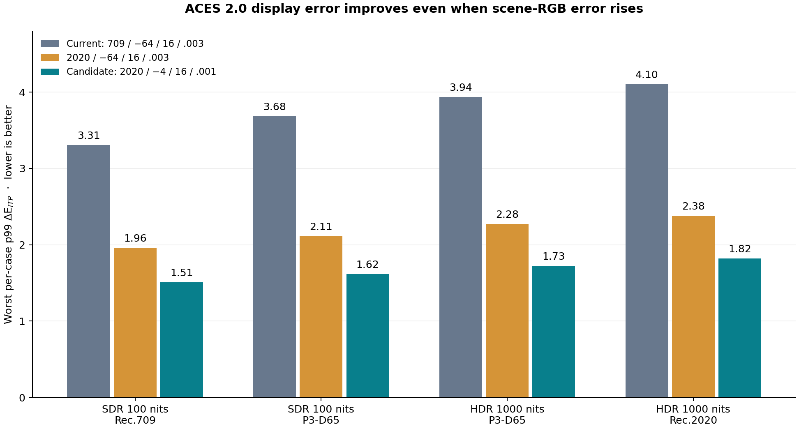
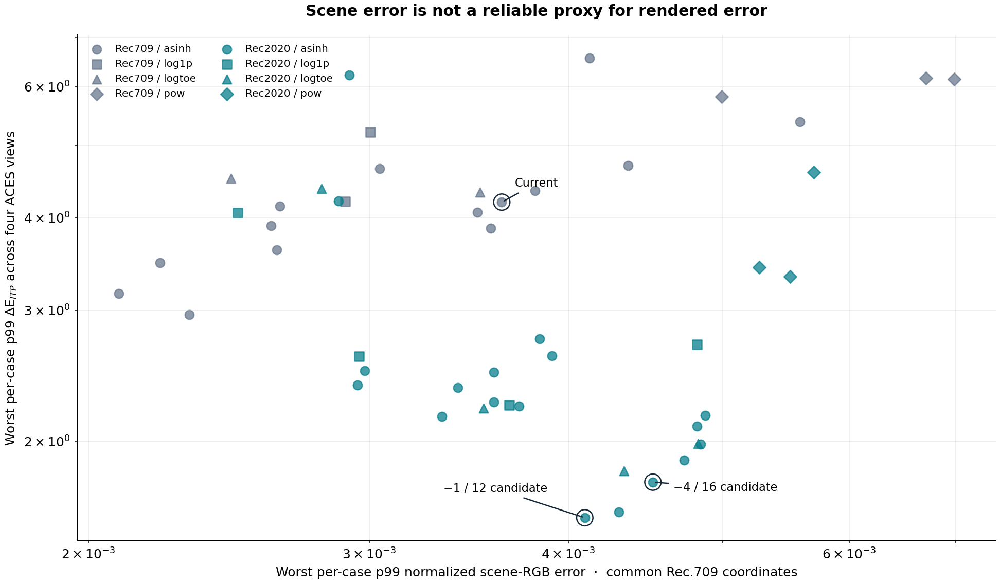
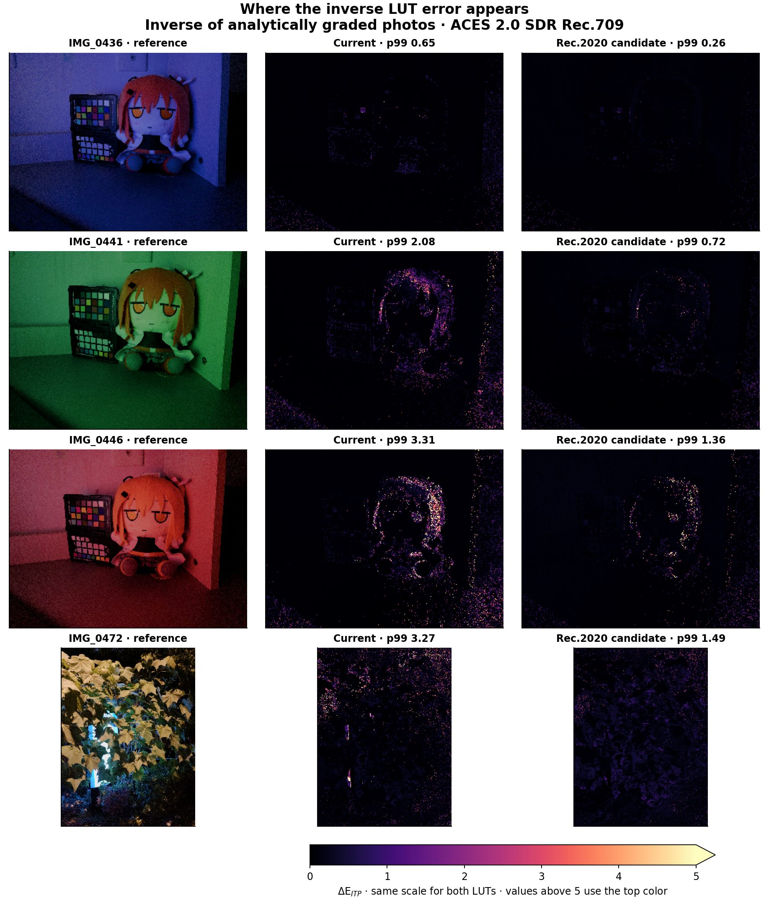
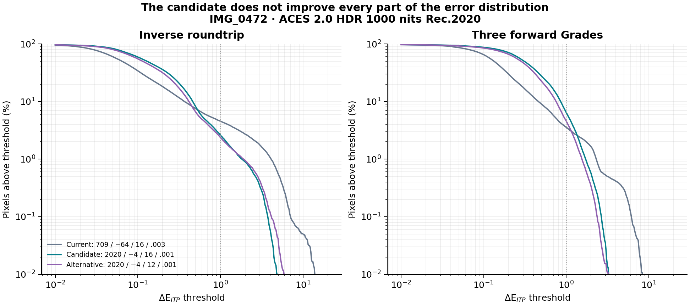
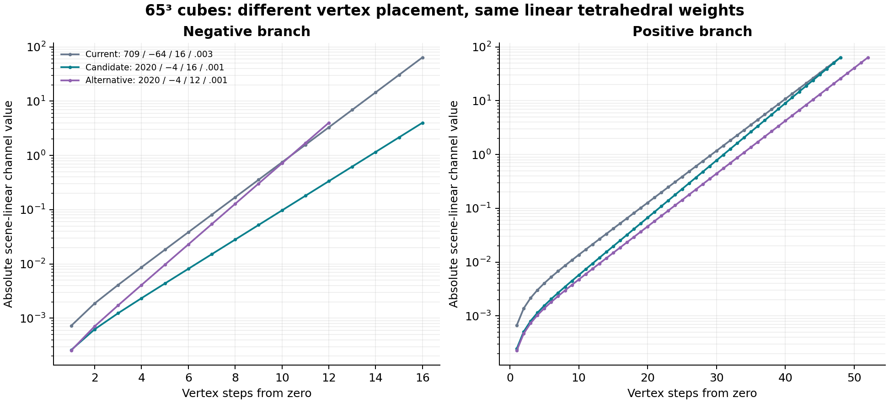

# Findings

The current extension uses **one fixed signed linear Rec.709/D65 LUT basis for every supported Blender scene working space**. Its 65³ grid covers −64…+64 per channel, with 16 cells below zero and 48 above. The asymmetric asinh shaper uses positive κ = 0.003. Native matrices convert scene coordinates to and from this fixed boundary; Grade white adaptation is part of the graded function.

This study screened **50 sampling configurations**, validated **10 on all 338,688 stored photo pixels**, and repeated four finalists with input exposure shifted by −2 and +2 stops. It tested signed linear Rec.2020/D65, negative bounds from −64 to −0.25, 8/12/16 negative cells, and asinh, log1p, linear-to-log and power shapers. Every cube remained 65³.

The most promising candidate for reducing the **worst per-case p99 displayed error across exposures** is:

- Fixed **linear Rec.2020/D65** sampling coordinates for every Blender working space.
- Channel bounds **−4…+64**, with **16 negative / 48 positive cells**.
- Asymmetric **asinh**, positive κ = **0.001**, negative κ ≈ **0.000395345719992**.
- The existing physical linear-RGB tetrahedral interpolation and boundary-cell extrapolation.

At original exposure, the worst p99 ΔE_ITP falls from **4.105 to 1.823**, a **55.6% reduction**. The corresponding normalized scene-RGB p99 rises from **0.003427 to 0.004296**. This directly supports evaluating after the view transform instead of optimizing RGB error alone.

**This is a candidate, not a production change or a universal optimum.** It reduces larger errors but can increase the number of moderate errors: the worst fraction above ΔE_ITP 1 rises from **4.55% to 6.46%** at original exposure and from **6.23% to 10.34%** at +2 stops. A 12-negative-cell alternative has fewer such errors, but worse p99 at +2 stops. The production extension remains unchanged.



Each bar is the largest p99 among four photographs and five workloads. It is neither a pooled percentile nor a maximum-pixel error. The shorthand in figure legends is basis / negative limit / negative cell count / positive κ.

# Controlled experiment

## What stays fixed

The analytic grading function, Grade whites, Stage 1 corrections, Tone/Color settings, solver policy, cube resolution and interpolation rule are identical across candidates. Only the RGB coordinates and vertex positions used to approximate that function change. Rec.2020 primaries are **not** substituted into modCAM16, the Grade-white interpretation, or the Stage 1 control anchors.

Using column vectors, let $x$ be canonical linear Rec.709/D65, let $f_0$ be the existing exact-evaluation path, and let $M_{709}$ and $M_{2020}$ convert their RGB values to XYZ/D65. Define

$$
T=M_{2020}^{-1}M_{709},\qquad z=Tx.
$$

The Rec.2020 cube samples

$$
f_b(z)=T f_0(T^{-1}z).
$$

After interpolation, the answer in the common comparison coordinates is

$$
\widehat f_0(x)=T^{-1}\mathcal I_{G_b}[f_b](Tx),
$$

where $\mathcal I_{G_b}$ is tetrahedral interpolation on candidate grid $G_b$. Without approximation, the surrounding changes of basis cancel exactly. Rec.709 and Rec.2020 both use D65, so $T$ needs no chromatic adaptation.

For a Blender scene space $s$, with white $w_s$, its conversion into canonical coordinates is

$$
B_s=M_{709}^{-1}C_{\mathrm{Bradford}}(w_s\to D65)M_s.
$$

The proposed boundary is therefore $TB_s$ into the cube and $B_s^{-1}T^{-1}$ out. These matrices can be composed with the existing native wrappers. **The cube remains reusable when Blender's scene working space changes.** Each Grade retains its own selected white and its existing Bradford handling inside the function. The numerical covariance test covers Linear Rec.709, Linear Rec.2020 and ACEScg; the experimental cube has not been installed into or rendered by a new native Blender graph.

For an ordinary Forward node, Stage 1 is still outside the nonlinear cube. For an ordinary Inverse node, its inverse matrix is still applied after the inverse nonlinear cube. Stack cubes include every Stage 1 and the complete Grade sequence. The sampling experiment preserves those distinctions.

## Photographs, Grades and workloads

The available fixtures are **IMG_0436, IMG_0441, IMG_0446 and IMG_0472**, encoded as scene-linear Rec.2020/D65. Each stored fixture contains 84,672 pixels: every twelfth row and column from the original EXR, without filtering or clipping. “All pixels” here means all **stored fixture pixels**, not every pixel in the original full-resolution EXRs. Negative channel values are preserved.

Screening used 2,048 deterministic pixels per image, seed 1140065. The full pass includes 330,496 additional pixels that were not used for screening. Those additional pixels are from the same four scenes; they are not an independent set of photographs. The candidate's held-out worst p99 is 1.827 versus 4.101 for the current cube, consistent with the full-data comparison.

The Grade settings are exactly recorded in each run's `metadata.json` and the compact `summary.json`. They reuse the 1.15.0 working-white precision bundle: A has white D65, B has white ACES, and C has white D50. Their Stage 1 matrices are rebased versions of the D65-authored corrections. Tone reference white is 203 nits. No camera or scene normalization is inferred from the images.

Five workloads cover:

1. Ordinary B Forward, with Stage 1 outside the nonlinear LUT.
2. Ordinary B Inverse applied directly to the photographed colors.
3. Ordinary B Inverse applied to an analytically forward-graded photograph.
4. A Forward → B Inverse → C Forward, baked as one full Stack.
5. A Forward → B Forward → C Forward, baked as one full Stack.

Every reference uses the float64 forward math and the existing best-effort inverse solver, with no reference LUT interpolation. Inverse comparisons measure agreement with that selected numerical inverse, **not proof that the forward function has a unique exact inverse everywhere**. The inverse-roundtrip reference is the numerical inverse of the analytic forward result, rather than an assumption that it must equal the original image.

Cube values are stored as float32; CPU interpolation uses float64 physical coordinate weights. This study does not include native GPU precision, half-float transport, display quantization, real monitor black level, flare, or spatial/temporal visibility masking.

# ACES output paths and metrics

## Four requested output transforms

The analysis uses **Blender 5.2.2's bundled OCIO 2.5.0** and its stock configuration. Canonical scene RGB is converted with the config's Linear Rec.709 → ACES2065-1 transform, then passed through OCIO's actual ACES 2.0 output built-ins.

| Output | Exact built-in suffix | Display-code metric encoding |
| --- | --- | --- |
| SDR 100 nits Rec.709 | `SDR-100nit-REC709_2.0` | BT.1886, ideal zero black (gamma 2.4) |
| SDR 100 nits P3-D65 | `SDR-100nit-P3-D65_2.0` | sRGB transfer, matching Blender Display P3 |
| HDR 1000 nits P3-D65 | `HDR-1000nit-P3-D65_2.0` | ST 2084 PQ |
| HDR 1000 nits Rec.2020 | `HDR-1000nit-REC2020_2.0` | ST 2084 PQ |

Each complete built-in name starts with `ACES-OUTPUT - ACES2065-1_to_CIE-XYZ-D65 - `. Creative white is **D65** for all four. There is no extra look or view-exposure adjustment. HDR P3 is constructed from the official built-in and its P3-D65 PQ encoding even though Blender's stock display list does not offer it as the same named preset.

The built-ins return XYZ with **Y = 1 corresponding to 100 cd/m²**, including the HDR transforms. Multiplying by 100 converts to absolute display nits. This is independently checked with black and bright neutral probes: the SDR outputs approach 100 nits and HDR outputs approach 1000 nits. An 18% neutral renders at approximately 10 nits SDR and 14.51 nits HDR; it is not treated as 18 nits display light.

ACES rendering parameters and display encoding are separate. Changing the P3 SDR encoding convention would change the code-error column, but not the absolute-light or ΔE_ITP results.

## Error definitions

Scene RGB remains useful for numerical correctness, later edits, and other display transforms. All candidates are measured in the **same canonical Rec.709 coordinates**, so merely using a wider basis cannot artificially shrink the RGB error norm. For approximation $y_L$ and reference $y_A$:

$$
e_{\mathrm{RGB}}=\frac{\lVert y_L-y_A\rVert_\infty}{1+\lVert y_A\rVert_\infty}.
$$

The JSON also records unnormalized absolute RGB error and relative error with a 0.001 denominator floor. None of these is a percentage brightness error.

For each ACES view $V_v$, both outputs are rendered to absolute XYZ. Those values are converted to Rec.2020 linear light, then BT.2100 LMS, then PQ and ITP. With $T=0.5C_T$ and $P=C_P$:

$$
\Delta E_{ITP}=720\sqrt{(\Delta I)^2+(\Delta T)^2+(\Delta P)^2}.
$$

The matrix and PQ constants are explicit in `tests/blender/aces_metrics.py`; the ITP implementation agrees with Colour's independent BT.2100 PQ implementation. ITU-R BT.2124 defines this as a color-difference metric for television. A value around 1 is a useful potential visibility threshold under sensitive adaptation, **not a guarantee of a visible difference in every photograph or viewing environment**.

The primary score is

$$
E_{99}=\max_{\text{image, workload, view}}P_{99}(\Delta E_{ITP}).
$$

The report also retains p99.9, maximum, RMS, mean, fractions above 1/2/5, luminance difference in nits, maximum display-channel difference in nits, and maximum encoded-channel difference. The full JSON contains all distributions per image/workload/view. “Mean p99” below is the arithmetic mean of 80 case percentiles, not a pooled percentile. “Worst fraction > 1” is the largest of the 80 per-case fractions. Those maxima need not come from the same case as the worst p99.

Code errors use mathematical display encodings on the split XYZ path. OCIO's combined CPU display processors agree within the documented float32/encoding approximation tolerances; tiny XYZ cancellation near a zero channel can amplify into approximately 0.00012 code value while representing only about $4\times10^{-8}$ nits. Primary ΔE and luminance metrics do not depend on this encoding detail.

# Results at original exposure

## Display error by output

| ACES 2.0 output | Current 709 | 2020, same grid | 2020, −4 / 16 / .001 | Reduction vs current |
| --- | --- | --- | --- | --- |
| SDR100_Rec709 | 3.308 | 1.961 | 1.510 | 54.3% |
| SDR100_P3D65 | 3.683 | 2.112 | 1.617 | 56.1% |
| HDR1000_P3D65 | 3.938 | 2.275 | 1.726 | 56.2% |
| HDR1000_Rec2020 | 4.105 | 2.380 | 1.823 | 55.6% |

Switching only the RGB basis to Rec.2020 already improves the worst p99 substantially. Moving the negative limit closer to zero and concentrating more vertices near zero improves it further. This does not establish that either change will help every color, Grade or workload.

## All ten fully evaluated configurations

All values below use all stored pixels at original exposure. The positive endpoint is always +64. “Cells” in the first column means negative-side cells; the other $64-n_-$ cells are positive.

| Basis / negative bound / cells / shape | Worst p99 | Mean p99 | Worst p99.9 | Max ΔE | Worst % > 1 | Scene p99 | Outside cube |
| --- | --- | --- | --- | --- | --- | --- | --- |
| Rec2020 / −1 / 12 / asinh 0.001 | 1.774 | 0.631 | 5.552 | 13.452 | 4.53% | 0.003721 | 0.00591% |
| Rec2020 / −4 / 16 / asinh 0.001 | 1.823 | 0.691 | 5.833 | 11.738 | 6.46% | 0.004296 | 0.00000% |
| Rec2020 / −4 / 12 / asinh 0.001 | 1.904 | 0.655 | 5.913 | 12.421 | 4.58% | 0.003836 | 0.00000% |
| Rec2020 / −4 / 12 / logtoe 0.001 | 1.915 | 0.658 | 6.448 | 13.323 | 5.06% | 0.004012 | 0.00000% |
| Rec2020 / −4 / 12 / asinh 0.0003 | 1.989 | 0.721 | 6.640 | 13.618 | 6.96% | 0.004537 | 0.00000% |
| Rec2020 / −4 / 16 / asinh 0.003 | 2.264 | 0.841 | 5.053 | 10.424 | 6.47% | 0.003606 | 0.00000% |
| Rec2020 / −4 / 12 / asinh 0.003 | 2.273 | 0.810 | 6.034 | 12.428 | 5.14% | 0.003217 | 0.00000% |
| Rec2020 / −64 / 16 / asinh 0.003 | 2.380 | 0.884 | 5.970 | 12.161 | 6.56% | 0.003679 | 0.00000% |
| Rec709 / −0.25 / 16 / asinh 0.003 | 3.193 | 0.956 | 6.634 | 15.879 | 3.34% | 0.002952 | 0.82908% |
| Rec709 / −64 / 16 / asinh 0.003 | 4.105 | 1.144 | 8.956 | 16.328 | 4.55% | 0.003427 | 0.00000% |

The −1 / 12 candidate has the lowest p99 at original exposure, but a higher maximum error and a smaller reliable sampling domain. It already extrapolates a few stored fixture pixels and extrapolates more at +2 stops. The −4 / 16 candidate is preferable **if the selection objective is lower worst p99 across the tested exposures**. The −4 / 12 candidate is preferable for lower mean p99 and fewer moderate errors at original exposure. No candidate dominates the table.

## Workload breakdown

Each cell is the worst p99 ΔE_ITP across images and views for that workload.

| Workload | Current | −4 / 16 candidate | −4 / 12 alternative |
| --- | --- | --- | --- |
| forward | 1.518 | 1.412 | 1.336 |
| inverse | 3.170 | 1.215 | 1.151 |
| inverse_roundtrip | 4.105 | 1.823 | 1.904 |
| mixed_stack | 2.657 | 1.011 | 0.922 |
| forward_stack | 2.307 | 1.717 | 1.550 |

## Luminance and encoded-channel error

These are again worst per-case p99 values. Code error is a floating-point normalized code difference before integer quantization, not a number of 8-bit or 10-bit code steps.

| Output | Current p99 \|ΔY\| nits | Current p99 max code error | Candidate p99 \|ΔY\| nits | Candidate p99 max code error |
| --- | --- | --- | --- | --- |
| SDR100_Rec709 | 0.1439 | 0.011589 | 0.0994 | 0.005544 |
| SDR100_P3D65 | 0.1393 | 0.007014 | 0.0985 | 0.005347 |
| HDR1000_P3D65 | 0.2678 | 0.008446 | 0.2397 | 0.004721 |
| HDR1000_Rec2020 | 0.2653 | 0.007090 | 0.2394 | 0.003205 |

## What RGB-only ranking would miss



This scatter uses the 8,192-pixel screening set. Its rankings need not match the full-data table exactly. Configurations towards the lower right can have larger scene-RGB errors but smaller displayed errors. The full-data comparison confirms the same reversal for the proposed candidate. ACES tone and gamut rendering compress some scene differences and magnify the perceptual effect of others; a single scene-RGB norm does not encode that sensitivity.



These maps use the inverse-roundtrip workload and the SDR Rec.709 output. The left column is an sRGB-encoded preview of the rendered reference light for a browser; that preview is not used in the error calculation. All heatmaps use the same ΔE scale, with values above 5 shown at the top color. Large isolated errors remain; the candidate's largest error over all 80 original-exposure cases is **11.738 ΔE_ITP**, compared with **16.328** currently. The candidate is not visually lossless.



The candidate concentrates more samples close to zero, reducing some larger errors while making other moderate errors more frequent. This is especially apparent in the forward Stack. A p99 improvement should therefore be accompanied by the threshold fractions and tail plots, rather than treated as a complete quality verdict.

# Exposure and negative-range robustness

These runs multiply the **scene input before grading** by $2^{-2}$ or $2^{+2}$. They are not extra exposure applied after grading or inside the view. All stored pixels are evaluated again; the same cubes and Grade settings are reused.

| Input stops | Grid | Worst p99 ΔE | Worst % > 1 | Outside cube |
| --- | --- | --- | --- | --- |
| -2 | Rec709_neg64_n16_asinh0.003 | 2.998 | 5.01% | 0.00000% |
| -2 | Rec2020_neg4_n16_asinh0.001 | 1.374 | 2.87% | 0.00000% |
| -2 | Rec2020_neg4_n12_asinh0.001 | 1.413 | 1.97% | 0.00000% |
| -2 | Rec2020_neg1_n12_asinh0.001 | 1.357 | 1.98% | 0.00000% |
| +0 | Rec709_neg64_n16_asinh0.003 | 4.105 | 4.55% | 0.00000% |
| +0 | Rec2020_neg4_n16_asinh0.001 | 1.823 | 6.46% | 0.00000% |
| +0 | Rec2020_neg4_n12_asinh0.001 | 1.904 | 4.58% | 0.00000% |
| +0 | Rec2020_neg1_n12_asinh0.001 | 1.774 | 4.53% | 0.00591% |
| +2 | Rec709_neg64_n16_asinh0.003 | 6.385 | 6.23% | 0.00000% |
| +2 | Rec2020_neg4_n16_asinh0.001 | 2.086 | 10.34% | 0.00591% |
| +2 | Rec2020_neg4_n12_asinh0.001 | 2.863 | 7.25% | 0.00591% |
| +2 | Rec2020_neg1_n12_asinh0.001 | 2.353 | 7.25% | 0.44879% |

The −4 / 16 candidate's worst p99 is **1.374 / 1.823 / 2.086** at −2 / 0 / +2 stops, compared with **2.998 / 4.105 / 6.385** currently. Its reduction is approximately **54.2% / 55.6% / 67.3%**.

There is no extrapolation for the −4 candidate at original or −2-stop exposure in these workloads. At +2 stops, the brightest fixture has Rec.2020 inputs as low as −4.9023, so five pixels in an 84,672-pixel case fall outside the −4 limit: **0.00591%**. The −1 candidate's worst outside fraction reaches **0.44879%**. Values outside the cube use boundary-cell extrapolation and are never clipped to the domain.

Reducing the negative extent gives up coverage. It cannot be justified solely by Rec.2020 containing more natural colors with nonnegative components: real images, noise, matrices and creative corrections can all produce more negative values. The positive extent +64 was not varied in this study. More extreme signed/HDR inputs and substantially different Grade parameters remain an open validation area before making this a general default.

# Shapers: exact definitions and observed behavior

Let $n_-$ and $n_+$ be the negative and positive cell counts, $n_-+n_+=64$, and let $R_-,R_+>0$ be the endpoint magnitudes. With positive shaping constant $k_+$ and monotone shape $h$, choose $k_-$ to match the first derivative at zero:

$$
\frac{k_-h(R_-/k_-)}{n_-}=\frac{k_+h(R_+/k_+)}{n_+}.
$$

For asinh, log1p and linear-to-log, vertices are

$$
x_i=\begin{cases}
-k_-h^{-1}\!\left(\dfrac{n_--i}{n_-}h(R_-/k_-)\right),&0\leq i\leq n_-,\\
k_+h^{-1}\!\left(\dfrac{i-n_-}{n_+}h(R_+/k_+)\right),&n_-\leq i\leq64.
\end{cases}
$$

The functions tested are:

| Family | $h(t)$, for $t\geq0$ | Notes |
| --- | --- | --- |
| asinh | $\operatorname{asinh}(t)$ | Smooth signed join; first and second derivatives agree at zero |
| log1p | $\ln(1+t)$ | First derivative matches; second derivative has a signed join discontinuity |
| linear-to-log (`logtoe`) | $t$ if $t\leq1$; $1+\ln t$ otherwise | Linear near zero; first derivative continuous at the toe |
| power | Direct decode $R v^q$, $v\in[0,1]$ on each side | Tested $q=4,6,8$; zero derivative at the origin |

The current asinh parameters are $R_-=R_+=64$, $n_-=16$, $k_+=0.003$, $k_-=0.0008983933245901802$. The proposed values are $R_-=4$, $R_+=64$, $n_-=16$, $k_+=0.001$, $k_-=0.0003953457199919977$. The 12-cell alternative has $k_-=0.00026288209528660714$.

For a query component in a cell, interpolation uses

$$
t=\frac{x-x_i}{x_{i+1}-x_i}.
$$

**The shaper chooses sample locations; it does not replace physical linear-RGB distances with logarithmic interpolation weights.** Outside the endpoints, the same expression extrapolates from the boundary cell. All candidates use the same tetrahedron-selection rule.



The initial 38 candidates tested both bases with 19 profiles each. Twelve follow-ups explored smaller positive κ, matched small-κ log alternatives, and additional Rec.709 comparisons. `candidates()` in `lut_sampling.py` is the complete reproducible list; the result JSON also records all 65 axis values for every cube.

Asinh remains a good choice in this experiment. The best screened log1p option had worst p99 **2.238**, the best linear-to-log **1.825**, and the best power option **3.333**, compared with the best asinh screening value **1.579**. These are screening values, not the full-data scores. The fully evaluated linear-to-log candidate reaches **1.915**; it does not improve on the selected asinh candidate overall. Making κ still smaller is not monotonically beneficial: it trades midtone/highlight sampling for values close to zero.

# Bake cost and validation

The candidate used approximately **0.26 s** for the nonlinear forward cube, **4.07 s** for the inverse cube, **4.92 s** for the mixed Stack and **0.79 s** for the forward Stack in their original fresh numerical bakes. These are single measurements on this host, excluding Blender publication and edit debounce, not a five-second guarantee. The full passes reused those cached cubes. No extension runtime dependency or compiled component was introduced.

The candidate inverse cube reports 102 approximate vertices out of 274,625, with worst normalized forward reproduction residual 0.03277. The mixed Stack reports 114 approximate vertices and residual 0.02158. These are solver diagnostics before interpolation; they must not be confused with the photo error tables or a guarantee of a unique inverse. The 12-cell alternative reports fewer approximate vertices (73 and 68), further illustrating that one metric does not determine the final ranking.

**123 focused checks pass**, covering current-grid equivalence, current tetrahedral equivalence, affine interpolation/extrapolation for all 50 candidates, coordinate inverses, fixed-cube covariance in all three Blender scene spaces, ITP/PQ agreement with an independent implementation, absolute output luminance, black, self-comparison and complete OCIO display-path agreement.

The recreated current cube also reproduces the earlier 1.15.0 precision report's scene-RGB p99 and maximum measurements on the matching screening pixels: the largest difference across the compared records is below $4\times10^{-16}$. This confirms that the comparison did not silently change the grade to favor another basis.

Runtime extension files, DCTL, controls, file formats and compatibility policy are unchanged. These analysis tools are not a new Buck2 release gate. Native GPU tests and a production implementation of the candidate are not claimed.

# Reproduce and extend

The study source is under `tests/blender/`: `aces_metrics.py`, `lut_sampling.py`, `evaluate_lut_sampling.py`, `test_lut_study.py`, `report_lut_sampling.py` and `run_lut_study.py`. The runner imports the pure model package without registering the Blender extension. Required analysis packages are NumPy, PyOpenColorIO, Colour for the independent checks, and Matplotlib for figures. Use OCIO 2.5.0 and the recorded Blender config for the same ACES implementation. These packages are not bundled into the extension.

```sh
python tests/blender/run_lut_study.py test_lut_study \
  --ocio-config /path/to/blender/colormanagement/config.ocio

python tests/blender/run_lut_study.py evaluate_lut_sampling \
  --ocio-config /path/to/blender/colormanagement/config.ocio \
  --output results/lut-study --mode screen --grids all

python tests/blender/run_lut_study.py evaluate_lut_sampling \
  --ocio-config /path/to/blender/colormanagement/config.ocio \
  --output results/lut-study --mode full \
  --grids Rec709_neg64_n16_asinh0.003,Rec2020_neg4_n16_asinh0.001
```

Select the other full-run names from `results/lut-study/full/ranking.json`. Repeat the four exposure finalists with `--exposure -2` and `--exposure 2`, each in its own output directory. Set `OPENBLAS_NUM_THREADS=1` and `OMP_NUM_THREADS=1` to match this study's numerical bake timing setup.

```sh
python tests/blender/run_lut_study.py report_lut_sampling \
  --ocio-config /path/to/blender/colormanagement/config.ocio \
  --results results --output docs/engineering/lut-sampling
```

The report builder needs all ten full results, all four finalists at both exposure offsets, and their cached pixel arrays. Those arrays are regenerated by full evaluation. Use a **fresh output directory whenever study code, model, fixtures or OCIO configuration changes**; the caches are an optimization within one experiment, not a general cross-version cache protocol. Production projects receive no migration code.

The saved measurements include 50 original-exposure screening results, 10 original-exposure full results, four screening and four full results at each exposure offset, metadata, all Grade settings, file hashes and validation records. Summary numbers are also collected in `summary.json`.

For a later implementation decision, retain both scene and display measures, select an explicit objective among worst p99 and threshold fractions, and examine additional scenes and stronger signed corrections. View-only optimization can hide scene errors that become visible under a subsequent grade, exposure change or different output transform.

# Primary references

- [ACES output-transform parameters](https://docs.acescentral.com/system-components/output-transforms/parameters/): rendering gamut, luminance and creative-white parameters.
- [OpenColorIO built-in transform registry](https://opencolorio.readthedocs.io/en/latest/api/transforms.html#PyOpenColorIO.BuiltinTransformRegistry): the actual ACES 2.0 transforms are selected by the built-in names recorded above.
- [ITU-R BT.2124-0](https://www.itu.int/dms_pubrec/itu-r/rec/bt/R-REC-BT.2124-0-201901-I!!PDF-E.pdf): ΔE_ITP definition and interpretation.
- The bundled Blender configuration and installed OCIO implementation are the primary implementation sources for this measurement. Their version and SHA-256 are recorded in `metadata.json`.
