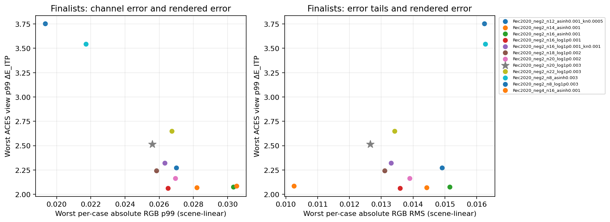
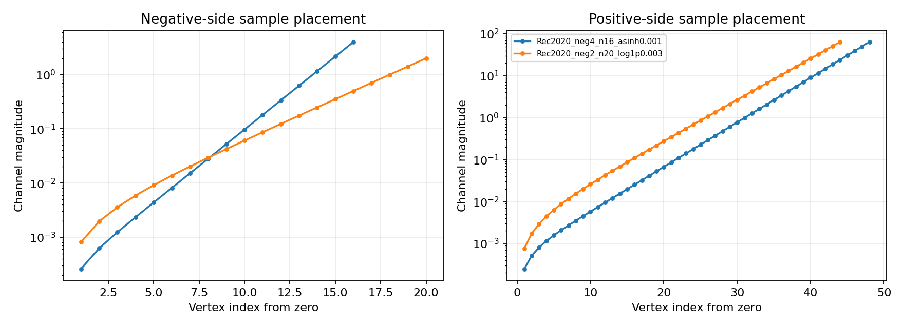

# LUT shaper comparison

Selected among the tested −2…64 candidates: **Rec2020_neg2_n20_log1p0.003**.

The objective is the maximum ratio to the baseline across four worst per-case ACES p99 ΔE_ITP metrics, three absolute scene-RGB p99 metrics and three absolute scene-RGB RMS metrics. Ratios above one are regressions. This is a measured compromise, not a universal optimum.

| Grid | Worst ACES p99 | Worst absolute RGB p99 | Worst absolute RGB RMS | Balanced ratio | Worst outside fraction |
|---|---:|---:|---:|---:|---:|
| Rec2020_neg4_n16_asinh0.001 | 2.085620 | 0.03051798 | 0.01025971 | 1.000000 | 0.00005905 |
| Rec2020_neg2_n20_log1p0.003 | 2.514019 | 0.02558292 | 0.01265570 | 1.279837 | 0.00184240 |
| Rec2020_neg2_n18_log1p0.002 | 2.242578 | 0.02584148 | 0.01310600 | 1.327583 | 0.00184240 |
| Rec2020_neg2_n16_log1p0.001_kn0.001 | 2.321685 | 0.02633153 | 0.01330854 | 1.347341 | 0.00184240 |
| Rec2020_neg2_n22_log1p0.003 | 2.651040 | 0.02674404 | 0.01342336 | 1.363161 | 0.00184240 |
| Rec2020_neg2_n16_log1p0.001 | 2.063685 | 0.02650314 | 0.01359318 | 1.377258 | 0.00184240 |
| Rec2020_neg2_n20_log1p0.002 | 2.163798 | 0.02694681 | 0.01389452 | 1.413307 | 0.00184240 |
| Rec2020_neg2_n14_asinh0.001 | 2.071091 | 0.02819957 | 0.01442478 | 1.462748 | 0.00184240 |
| Rec2020_neg2_n12_asinh0.001_kn0.0005 | 2.271591 | 0.02699529 | 0.01490481 | 1.516085 | 0.00184240 |
| Rec2020_neg2_n16_asinh0.001 | 2.075912 | 0.03033461 | 0.01515282 | 1.542065 | 0.00184240 |
| Rec2020_neg2_n8_asinh0.003 | 3.545380 | 0.02170805 | 0.01627303 | 1.743593 | 0.00184240 |
| Rec2020_neg2_n8_log1p0.003 | 3.752791 | 0.01932690 | 0.01623955 | 1.916492 | 0.00184240 |

Each percentile is computed per fixture, exposure and workload before taking the worst case. Absolute RGB is the maximum channel error per pixel, measured separately in Linear Rec.709, Linear Rec.2020 and ACEScg. Display metrics use the four declared OCIO ACES 2.0 output transforms. Signed/HDR queries extrapolate; they are never removed or clipped.

The full records include heldout distributions excluding the screening samples, quantiles, maxima, RMS, luminance and display-code errors, solver diagnostics and domain counts. JSON/CSV tables and input fingerprints are the authority for the numbers.

Normal Buck2 reproduction: `buck2 build //:lut_shaper_evaluation //:lut_shaper_report` and `buck2 test //:lut_shaper_experiment_test //:lut_shaper_full_result_test`.
