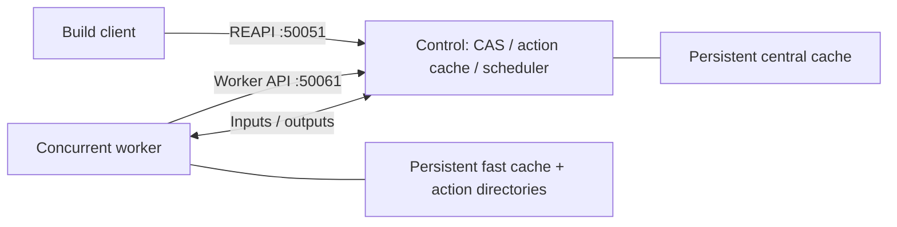

# NativeLink deployment

Docker Compose runs a NativeLink control service (CAS, action cache, scheduler)
and one concurrent Linux worker through the host Docker daemon. Clients can run
on the Linux Docker host or in development containers attached to its network.
NativeLink is pinned to **1.8.3**; the worker Dockerfile pins the Debian 13 base
image and verifies the release archive's SHA-256.

## Folder structure

```text
remote_execution/
├── README.md                 Deployment and operations
├── re                        CLI entrypoint
├── BUCK                      Public Buck targets
├── docker/
│   ├── Dockerfile            Worker runtime and system dependencies
│   ├── .dockerignore         Docker build-context exclusions
│   ├── compose.yaml          Services, network, and persistent volumes
│   ├── control.json5         CAS, action cache, scheduler, and APIs
│   ├── worker.json5          Worker execution and cache configuration
│   └── action-entrypoint.sh  Per-action HOME/XDG/TMP directories
├── cli/
│   └── main.py               Deployment and validation commands
├── tests/
│   ├── README.md             Validation workflow and evidence
│   ├── VALIDATION.md         Recorded deployment results
│   ├── BUCK                  Independent validation actions
│   ├── probe.py              Local/remote execution and cache probe
│   └── validation-targets.json  Repository acceptance targets
└── .state/                   Ignored deployment settings and evidence
```

## Start

Requirements: Linux x86_64, Docker daemon access, Docker Compose, Python 3,
and network access for image downloads. Install Buck2 on the client for builds,
tests, and deployment validation. Run from the repository root on the Docker host:

```sh
./remote_execution/re up
./remote_execution/re status
```

For a client inside a development container, explicitly attach that container:

```sh
./remote_execution/re up --workspace-container dev-container
```

Replace `dev-container` with its actual name. `up` builds the image, creates the
network, starts the services, and checks their health and worker registration.
Host clients use the discovered control-container bridge IP; container clients
use Docker DNS. Deployment metadata is stored in `.state/`; `up` writes the active
endpoint and image ID to a clearly marked managed block in the checked-in root
`.buckconfig`, leaving the rest of that file unchanged.

Ordinary Buck commands use remote execution by default. Run
`./remote_execution/re validate` to run 16 probes locally, then remotely, then
require 16 remote-cache hits after clearing disposable client state. For client
configuration and explicitly selecting local execution, see
[Buck client configuration](#buck-client-configuration) and
[validation details](tests/README.md).

## Buck client configuration

This repository uses Buck2
`2026-10-14-9a1876786f32806f6b65fc51f4c1c3077efc38a5` and its bundled prelude.
The checked-in root [.buckconfig](../.buckconfig) enables remote execution by
default and holds the endpoint, platform selection, and worker image identity.
[toolchains/remote_execution.bzl](../toolchains/remote_execution.bzl) defines the
client execution platform and Python-test profile; [BUCK](BUCK) exposes their
public platform labels. NativeLink's services are configured separately under
`remote_execution/docker/`.

Run from the repository root; see [Start](#start) for the optional
development-container argument:

```sh
./remote_execution/re up
./remote_execution/re validate
buck2 build //:perceptual_grade --show-output
buck2 test //libraries/color-core/tests:linear --remote-only
```

`re up` updates root `.buckconfig` with `root//remote_execution:platforms`, SHA-256
digests, the deployed REAPI endpoint with instance `main`, and the actual Docker
image ID. These updates appear in the tracked configuration diff; review them
with other deployment changes. The CLI rewrites only the block between
`# BEGIN NativeLink settings (managed by remote_execution/re)` and
`# END NativeLink settings`. Cells, parser, project, and other settings outside
that block remain unchanged.

Switch build and test execution by updating that same root configuration:

```sh
./remote_execution/re local
./remote_execution/re remote
```

`local` needs no Docker, service connection, or saved deployment state: it selects
`prelude//platforms:default`, sets `remote_execution.enabled = false`, and removes
remote-client settings from the block. `remote` requires a ready deployed worker
and writes its actual image ID and endpoints from deployment state. `up` starts
the deployment and selects remote execution. Stopping NativeLink does not
automatically select local mode; remote actions then fail.

Buck initializes remote connection addresses in its daemon. After switching modes
or endpoints, run `buck2 kill` once this checkout's commands are idle. The CLI
prints a reminder and does not kill the daemon automatically. Local execution
also requires any deferred dependency downloads to be available.

One Linux x86_64 build platform and one Python-test profile match the worker's
OS, architecture, and immutable image ID. They make no CPU or memory requests
and forbid automatic local fallback. Build platforms and test executor profiles
are separate: building a test executable remotely does not establish where its
test process ran. See the [validation guide](tests/README.md) for compatible Linux
suite commands, execution logs, cache reuse, and repository acceptance coverage.

## Runtime and scheduling



The deployment uses one private Docker network, `perceptual-grade-re`, and
publishes no host ports. Health/admin APIs use internal port 50052. Container
clients resolve `perceptual-grade-nativelink`; external LAN access and
authentication are not configured. The Compose project is a singleton per Docker
host: coordinate replacement or shutdown when several checkouts share it.

Worker matching uses exact OS, architecture, and Docker image identity. Actions
share available host CPU and RAM without per-action resource requests.
`max_inflight_tasks: 0` permits unlimited concurrent actions. Compose sets no CPU,
RAM, or PID quota, and the integration adds no thread ceilings. Programs retain
their own threading behavior and existing test settings. Buck's dependency graph
determines which actions can run concurrently.

Services run as UID 10001 with dropped capabilities and `no-new-privileges`.
Workers do not mount the developer checkout, home directory, Docker socket, or
externally installed tool environments. Clients supply declared inputs through
CAS, and Buck materializes returned outputs. Each action gets separate writable
HOME/XDG/TMP directories and must write build results only to declared outputs.
Actions share a worker UID and do not use per-action kernel namespaces, so this
deployment is intended for trusted development workloads.

## Operate and inspect

```sh
./remote_execution/re status
./remote_execution/re logs worker
./remote_execution/re logs --follow
./remote_execution/re down                 # Keep cache volumes
./remote_execution/re up --no-build        # Start the locally tagged image
./remote_execution/re local               # Select local Buck execution
./remote_execution/re remote              # Select the ready deployment
```

`status` checks service readiness and a registered worker with the expected image,
OS, and architecture. `up` updates root `.buckconfig` when the image or endpoint
changes. For container clients, include
`--workspace-container dev-container` when running `up`.

For execution-mode switches and daemon restart requirements, see
[Buck client configuration](#buck-client-configuration).
Logs rotate at 20 MiB per file, five files per service.
Use health/admin APIs and client execution logs for diagnosis; this stack does
not expose a Prometheus `/metrics` endpoint.

Cache retention defaults are 120 GiB central CAS, 1 GiB action cache, and 32 GiB
worker fast cache. Configure them through `NATIVE_CAS_MAX_BYTES`,
`NATIVE_AC_MAX_BYTES`, and `NATIVE_WORKER_CACHE_MAX_BYTES` when running `up`;
`RUST_LOG` controls logging. Settings persist in `.state/compose.env` and subsequent
commands use those recorded values. Cache eviction does not limit active action
storage or Docker image layers. `re down --purge-caches` deletes this deployment's
cache volumes.

## Runtime dependencies and upgrades

### The Dockerfile is the system runtime authority

**If a Buck build or test needs a missing system runtime dependency, add it to
[docker/Dockerfile](docker/Dockerfile), rebuild the image, and record the new image
identity in the root `.buckconfig` using `re up`.** Installing it in the workspace
shell or manually changing a running worker is not a repository fix. A command
succeeding on a developer machine does not establish that its remote runtime is
complete.

The worker image supplies the platform ABI and system tools: Debian/glibc,
shell/coreutils, GCC/G++, binutils, archive utilities, and required system shared
libraries. The image is a versioned build input through its immutable Docker
image ID. Do not infer its identity from a mutable tag or the Dockerfile's text:
package repositories can deliver different bytes on a later rebuild.

Buck remains the authority for source, generated files, language dependencies,
and pinned tool distributions. Python's standalone interpreter, Python wheels,
Lean/Clang, Blender, Xvfb/Mesa fixtures, Node, Rust/Cargo, wasm-bindgen,
npm/Cargo archives and Chromium have declared Buck inputs.
Their outputs must travel through the action's dependency closure. Do not copy
the checkout or prebuilt local outputs into the worker image to hide an omitted
dependency, and do not install application Python packages globally as a
substitute for their pinned Buck targets.

| Missing dependency or failure | Owning declaration |
| --- | --- |
| System executable, loader, libc/OS shared library | Worker `Dockerfile` package/runtime setup |
| Python/npm/Cargo package, pinned compiler, Blender/Node/Rust/browser distribution | Buck toolchain or third-party target |
| Test fixture, generated manifest, helper script, source file | Buck `deps`, `resources`, command inputs or output providers |
| Bundled compiler sibling libraries/headers | Full tool distribution as declared/hidden inputs |
| Writable home, temporary files, per-action caches | Action wrapper and declared outputs |
| GPU display and software rendering support | Declared Xvfb/Mesa fixture plus native test launcher |

For example, a compiler path serialized into a JSON resource does not by itself
declare the executable's runtime dependencies. The DCTL fixture therefore
exports compiler commands as `DefaultInfo.other_outputs`, and the Clang toolchain
attaches Lean's distribution so bundled LLVM shared libraries and headers are
available. The same rule applies to paths embedded in any generated manifest.

### Required dependency-change workflow

1. Inspect the failing remote command and stderr with `buck2 log what-failed` or
   `buck2 log what-ran --show-std-err`. Distinguish a missing executable from an
   executable whose ELF loader or shared library is absent. Check the declared
   input closure before adding system packages.
2. Change the owning declaration in the table above. For a platform package,
   modify the Dockerfile's installation/runtime setup and keep it noninteractive.
   For source or language artifacts, add explicit Buck dependencies and ensure
   subprocesses receive their complete runtime inputs.
3. Run `./remote_execution/re up`. It rebuilds and inspects the actual image,
   starts the matching worker, verifies registration, and updates the root
   `.buckconfig` with the endpoint, remote platform, and actual worker image ID.
4. Run `./remote_execution/re validate`, then build/test the affected real targets
   remotely. A warm local incremental result is insufficient evidence for an
   environment change. Validation runs 16 local probes, 16 fresh remote probes
   with concurrency and isolation checks, then requires 16 remote-cache hits.
   It clears only the disposable client's state between stages and resets that
   client's daemon before switching from local to remote. The live checkout's
   configuration, execution mode, and build outputs remain unchanged.
5. Record the dependency, image ID, affected targets, and validation results.
   Keep other active checkouts' image properties synchronized with the deployment.
   A worker registered under a new image ID must not accept old-image actions.

Build and test platform properties contain the exact `worker-image` ID. These
properties enter remote action keys, so changes to compilers, system libraries,
or the action wrapper cannot silently reuse results from the previous runtime.
Local actions do not upload results as if they came from the worker image.
The same rebuild and validation workflow applies to wrapper and NativeLink
configuration changes. See the [validation guide](tests/README.md) for evidence
and acceptance boundaries.

### NativeLink upgrades

For NativeLink upgrades, update the Dockerfile version/checksum and the default
image tag in `cli/main.py`, then review the tagged configuration schema.
Let active builds finish before replacement. Save
the current image ID from `.state/deployment.json`; a retained image can be
redeployed with `re up --image sha256:OLD_ID`. Check cache-format compatibility
before changing NativeLink versions; retaining an image is not a cache backup.

## Upstream references

- [NativeLink v1.8.3 release](https://github.com/TraceMachina/nativelink/releases/tag/v1.8.3)
- [Current Compose examples](https://github.com/TraceMachina/nativelink/tree/main/deployment-examples/docker-compose)
- [Tagged worker/server configuration schema](https://github.com/TraceMachina/nativelink/blob/v1.8.3/nativelink-config/src/cas_server.rs)
- [Tagged scheduler configuration schema](https://github.com/TraceMachina/nativelink/blob/v1.8.3/nativelink-config/src/schedulers.rs)

The current Compose examples matched v1.8.3 when checked on November 1, 2026.
Use the tagged schemas and executable validation when adapting examples.
